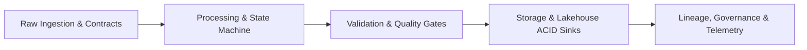
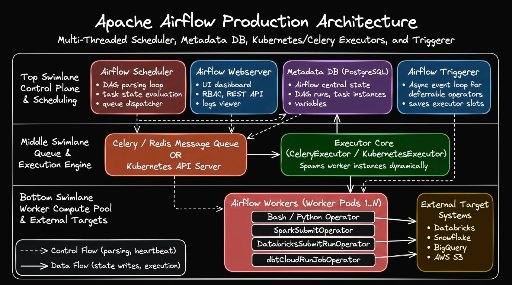
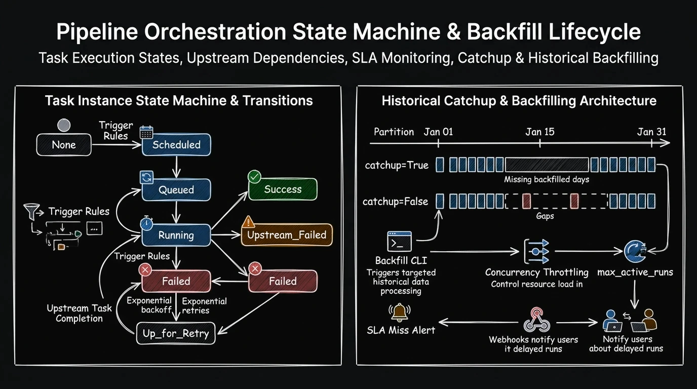
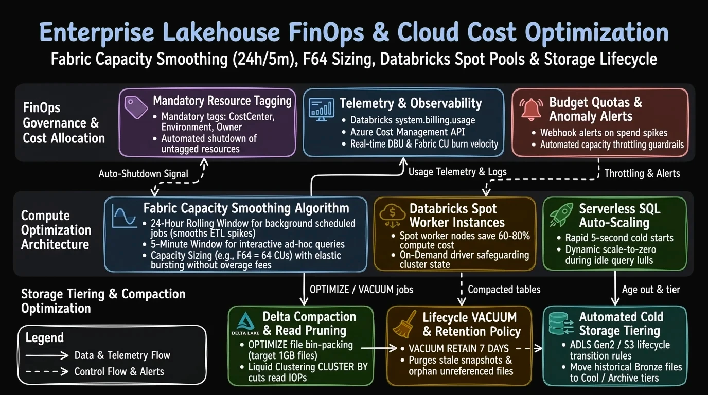

# 🚀 The DataOps, IaC & Platform Engineering Handbook

**Enterprise Reference Architecture, Production Incident Runbooks & 4-Tier Interview Preparation Matrix**

[](https://github.com/santoshjammi29/dataops-cicd-handbook/actions)
[](#)
[](LICENSE)

> Infrastructure as Code, automated data quality gates, Kubernetes for data workloads, and enterprise CI/CD pipelines.  
> Part of the **Modern Data Engineering & Lakehouse Systems Encyclopedia** ecosystem anchored by [**moderndataengineer.uk**](https://moderndataengineer.uk).

[Platform Architecture](#️-platform-architecture) • [Whiteboard Blueprints](#-whiteboard-blueprints) • [Interactive CLI](#-interactive-cli-explorer) • [Architectures](#️-architectural-deep-dives) • [Runbooks](#-production-incident-runbooks) • [Interview Matrix](#-4-tier-interview-preparation-matrix)  • [Core Concepts (115 Topics)](#-core-curriculum-concepts--topics) • [Sister Repositories](#-ecosystem-interlinking--sister-repositories)

---

## 🧠 Core Curriculum Concepts & Topics (115 Topics Covered)

> 💡 **Enterprise Knowledge Base Integration**: This repository implements **115 production topics** from the [Modern Data Engineering Systems Encyclopedia (921 Topics)](https://moderndataengineer.uk/concepts).

### 📑 Topics Directory at a Glance

| Pillar / Module | Topic Count | Key Core Primitives Covered | Status |
|:---|:---:|:---|:---:|
| 🌪️ **Apache Airflow & Pipeline Orchestration** | **52** | DAG (Directed Acyclic Graph), Task, Operator, Scheduler, and 48 more | ✅ Fully Documented |
| 🚀 **General Data Engineering, Dimensional Modeling & Governance** | **63** | ETL vs ELT, Dimension Table, Fact Table, Slowly Changing Dimensions Type 2 (SCD Type 2), and 59 more | ✅ Fully Documented |

<details open>
<summary><b>🌪️ Apache Airflow & Pipeline Orchestration (52 Topics)</b> — <i>Click to collapse/expand</i></summary>

| # | Topic / Concept | Level | Architectural Definition & Core Principle |
|:---:|---|:---:|---|
| 1 | **DAG (Directed Acyclic Graph)** | 🟢<br>Easy | A Directed Acyclic Graph (DAG) is a collection of all tasks you want to run, organized in a way that reflects their relationships and dependencies without any circular loops. |
| 2 | **Task** | 🟢<br>Easy | A Task is the basic unit of execution in Airflow, representing an instantiated node in a DAG that performs a specific piece of work. |
| 3 | **Operator** | 🟢<br>Easy | An Operator is a template or blueprint class in Airflow that defines a single task's behavior, execution logic, and parameters. |
| 4 | **Scheduler** | 🟢<br>Easy | The Scheduler is the heartbeat service of Airflow that monitors DAG files, resolves dependencies, and queues task instances for executor dispatch. |
| 5 | **Worker Node** | 🟢<br>Easy | A Worker Node is a dedicated compute instance or container responsible for pulling queued task instances and executing their payload logic. |
| 6 | **XCom (Cross-Communication)** | 🟢<br>Easy | XCom (Cross-Communication) is Airflow's built-in mechanism that allows tasks within the same DAG run to exchange small metadata payloads, parameters, or state identifiers. |
| 7 | **Airflow Variables** | 🟢<br>Easy | Airflow Variables are global key-value store entries maintained in the metadata database used to store non-sensitive runtime configurations and application constants. |
| 8 | **Airflow Connections** | 🟢<br>Easy | Airflow Connections are centralized configuration objects that store credentials, hostnames, ports, and authentication parameters required to interface with external systems. |
| 9 | **TaskInstance** | 🟢<br>Easy | A TaskInstance represents a specific run of a Task for a particular DagRun point in time, holding runtime state, attempt counts, and execution metrics. |
| 10 | **DagRun** | 🟢<br>Easy | A DagRun is an instantiation of an entire DAG representing a single execution instance for a specific logical date and trigger type. |
| 11 | **Trigger Rules** | 🟢<br>Easy | Trigger Rules dictate the exact upstream conditions required for a task to transition from queued to running. |
| 12 | **SLA (Service Level Agreement)** | 🟢<br>Easy | An SLA (Service Level Agreement) is a time duration threshold configured on tasks or DAGs that triggers automated alerts if execution exceeds expected operational windows. |
| 13 | **LocalExecutor** | 🟡<br>Intermediate | LocalExecutor is a single-node Airflow executor that runs tasks concurrently as separate OS subprocesses on the scheduler host using a process pool. |
| 14 | **CeleryExecutor** | 🟡<br>Intermediate | CeleryExecutor is a distributed executor that distributes task execution across an independent, horizontally scalable fleet of worker nodes via a message broker. |
| 15 | **KubernetesExecutor** | 🟡<br>Intermediate | KubernetesExecutor is a cloud-native executor that launches a dedicated, ephemeral Kubernetes pod for each individual task instance. |
| 16 | **TaskGroup** | 🟡<br>Intermediate | A TaskGroup is a visual and organizational UI construct in Airflow that hierarchically groups related tasks together without the overhead of SubDAGs. |
| 17 | **Sensors (BaseSensorOperator)** | 🟡<br>Intermediate | Sensors are specialized operators derived from BaseSensorOperator that poll an external system at regular intervals until a specific condition or criteria is met. |
| 18 | **Hooks** | 🟡<br>Intermediate | Hooks are reusable client interfaces that encapsulate connection logic, authentication, and API communication with external databases, platforms, and services. |
| 19 | **Custom Operators** | 🟡<br>Intermediate | Custom Operators are user-defined Python classes extending BaseOperator that implement specialized enterprise task execution logic. |
| 20 | **Dynamic Task Mapping** | 🟡<br>Intermediate | Dynamic Task Mapping (Airflow 2.3+) is an orchestration pattern that generates a dynamic number of parallel task instances at runtime based on upstream data outputs. |
| 21 | **Dataset-Driven Scheduling** | 🟡<br>Intermediate | Dataset-Driven Scheduling (Airflow 2.4+) is an event-based scheduling mechanism where DAGs trigger automatically when upstream producer tasks update defined data assets. |
| 22 | **Backfill** | 🟡<br>Intermediate | Backfill is the process of executing a DAG across a past historical date range to populate historical data or reprocess data after logic modifications. |
| 23 | **Pools (Airflow Pools)** | 🟡<br>Intermediate | Airflow Pools are concurrency control mechanisms used to restrict the number of simultaneous task instances accessing a specific shared resource or database. |
| 24 | **Priority Weights** | 🟡<br>Intermediate | Priority Weights determine the execution priority of queued task instances when multiple tasks compete for limited worker or pool slots. |
| 25 | **DAG Serialization** | 🔴<br>Advanced | DAG Serialization is an architectural subsystem that parses Python DAG files, serializes them into JSON blobs, and stores them in the metadata database for fast webserver retrieval. |
| 26 | **Metadata Database Tuning** | 🔴<br>Advanced | Metadata Database Tuning involves optimizing PostgreSQL/MySQL parameters, connection pooling, and table indexes to sustain high Airflow scheduling throughput. |
| 27 | **High Availability Scheduler** | 🔴<br>Advanced | The High Availability (HA) Scheduler architecture allows multiple Airflow scheduler instances to run concurrently in an active-active model without race conditions. |
| 28 | **Celery Worker Autoscaling** | 🔴<br>Advanced | Celery Worker Autoscaling dynamically scales the number of Celery worker processes or nodes based on active task queue depth and resource utilization. |
| 29 | **KubernetesPodOperator (KPO)** | 🔴<br>Advanced | KubernetesPodOperator (KPO) executes an arbitrary Docker container as an isolated Kubernetes pod, providing language-agnostic compute and complete dependency isolation. |
| 30 | **DAGs on Remote Storage** | 🔴<br>Advanced | An enterprise deployment pattern where Airflow DAG definitions are synchronized from object storage (S3/GCS) or Git repositories rather than baked into container images. |
| 31 | **Airflow REST API** | 🔴<br>Advanced | The Airflow REST API is an OpenAPI-compliant web interface providing programmatic access to trigger runs, manage variables, inspect logs, and audit cluster state. |
| 32 | **Grid View & Task Dependencies** | 🔴<br>Advanced | Grid View is Airflow's primary operational UI dashboard combining hierarchical task dependency trees with historical run statuses, duration charts, and log access. |
| 33 | **Statsd Metrics Integration** | 🔴<br>Advanced | Statsd Metrics Integration exports low-level Airflow operational telemetry to monitoring backends like Prometheus, Datadog, or Grafana. |
| 34 | **SLA Miss Callbacks** | 🔴<br>Advanced | SLA Miss Callbacks are custom Python functions invoked by the Airflow scheduler when tasks breach their configured Service Level Agreement duration thresholds. |
| 35 | **Custom Timetables** | 🔴<br>Advanced | Custom Timetables (Airflow 2.2+) allow developers to author arbitrary, non-cron scheduling logic that accounts for business calendars, holidays, and fiscal intervals. |
| 36 | **Multi-Tenant Airflow** | 🟣<br>Architect | Multi-Tenant Airflow is an enterprise architectural model where multiple disparate teams or business units share Airflow infrastructure while maintaining strict workload isolation. |
| 37 | **Airflow 2.x Architecture (DagProcessor)** | 🟣<br>Architect | The standalone DagProcessor architecture isolates the Python DAG parsing loop into dedicated, decoupled processes outside the Airflow scheduler daemon. |
| 38 | **Astronomer Astro vs OSS** | 🟣<br>Architect | The architectural evaluation between operating self-hosted open-source Apache Airflow versus managed enterprise platforms like Astronomer Astro. |
| 39 | **RBAC in Airflow** | 🟣<br>Architect | Role-Based Access Control (RBAC) in Airflow restricts user permissions to specific DAGs, connections, variables, and operational actions based on defined organizational roles. |
| 40 | **Custom Secret Backends** | 🟣<br>Architect | Custom Secret Backends enable Airflow to retrieve Connections and Variables directly from enterprise secret management systems at runtime without storing secrets in the metadata database. |
| 41 | **Cross-DAG Dependencies with Datasets** | 🟣<br>Architect | Cross-DAG Dependencies with Datasets models enterprise data pipelines as a decentralized, event-driven mesh of producer and consumer DAGs synchronized via data assets. |
| 42 | **Airflow + dbt Integration** | 🟣<br>Architect | The architectural integration between Airflow and dbt, leveraging orchestration frameworks like Cosmos to translate dbt models into native Airflow task dependency graphs. |
| 43 | **Airflow + Spark Integration** | 🟣<br>Architect | The architectural pattern for orchestrating large-scale Apache Spark batch and streaming jobs from Airflow across distributed compute clusters. |
| 44 | **Event-Driven Orchestration** | 🟣<br>Architect | An architectural paradigm where Airflow pipelines trigger immediately in response to external real-time events (webhooks, Kafka messages, file arrivals) rather than static schedules. |
| 45 | **Airflow 3.0 Preview** | 🟣<br>Architect | The architectural vision of Apache Airflow 3.0, introducing decoupled execution engines, multi-language task authoring, and native event-driven streaming primitives. |
| 46 | **Astronomer Cosmos (dbt Airflow Orchestration)** | 🔴<br>Advanced | An open-source library that parses a dbt project directory and renders each individual dbt model as a native, observable task in an Apache Airflow DAG. |
| 47 | **Airflow Data-Aware Scheduling (Datasets)** | 🟡<br>Intermediate | An event-driven orchestration feature in Airflow 2.4+ where downstream DAGs trigger automatically when upstream tasks produce specific data assets. |
| 48 | **Airflow Dynamic Task Mapping (`expand()`)** | 🔴<br>Advanced | Dynamically generating parallel task instances at runtime based on the output of an upstream task. |
| 49 | **Airflow KubernetesPodOperator Isolation** | 🔴<br>Advanced | Executing individual Airflow tasks inside dedicated, ephemeral Kubernetes pods with isolated dependencies and CPU/RAM limits. |
| 50 | **Airflow Connection Secrets Backend** | 🟡<br>Intermediate | Storing Airflow database and API connections in cloud secret managers (HashiCorp Vault, AWS Secrets Manager). |
| 51 | **Airflow Task SLA Alerting** | 🟢<br>Easy | Defining service level agreement thresholds on tasks and triggering automated notifications when tasks exceed duration limits. |
| 52 | **Airflow Data-Aware Dataset Scheduling** | 🟡<br>Intermediate | A declarative orchestration model in Apache Airflow 2.4+ where DAGs execute based on dataset updates produced by upstream tasks rather than fixed cron clocks. |

</details>

<details open>
<summary><b>🚀 General Data Engineering, Dimensional Modeling & Governance (63 Topics)</b> — <i>Click to collapse/expand</i></summary>

| # | Topic / Concept | Level | Architectural Definition & Core Principle |
|:---:|---|:---:|---|
| 1 | **ETL vs ELT** | 🟢<br>Easy | Ingestion paradigms defining whether data transformation occurs before (ETL) or after (ELT) landing in the target storage system. |
| 2 | **Dimension Table** | 🟢<br>Easy | A table in a dimensional database model containing descriptive attributes used to filter, group, and slice facts. |
| 3 | **Fact Table** | 🟢<br>Easy | A central table in a dimensional database model containing quantitative metrics and keys referencing dimension tables. |
| 4 | **Slowly Changing Dimensions Type 2 (SCD Type 2)** | 🟡<br>Intermediate | A design pattern that tracks historical attribute changes by creating new records with effective start/end dates. |
| 5 | **Change Data Capture (CDC)** | 🟡<br>Intermediate | A technology that monitors database logs in real-time to identify and capture insert, update, and delete actions. |
| 6 | **Data Orchestration** | 🟡<br>Intermediate | The practice of automating, scheduling, and monitoring complex data workflows and pipeline dependencies. |
| 7 | **Idempotency** | 🔴<br>Advanced | A data pipeline design property ensuring that executing a pipeline multiple times with the same input produces the exact same output. |
| 8 | **Kappa Architecture** | 🔴<br>Advanced | A software architecture design pattern that processes all data streams through a single streaming engine. |
| 9 | **Event-Driven Architecture** | 🔴<br>Advanced | A decoupled software architecture where data is produced and consumed as asynchronous event messages. |
| 10 | **Data Mesh** | 🟡<br>Intermediate | A decentralized architectural paradigm that shifts data ownership and governance from a central platform team to domain product teams. |
| 11 | **Data Contracts** | 🔴<br>Advanced | Formal agreements between data producers and consumers defining schema structure, data quality constraints, and SLA expectations. |
| 12 | **dbt (Data Build Tool)** | 🟢<br>Easy | A transformation tool that lets developers build, test, and document SQL models inside their data warehouse using SELECT statements. |
| 13 | **Data Observability** | 🟡<br>Intermediate | The practice of monitoring, alerting, and diagnosing the health and quality of data pipelines in production. |
| 14 | **Lakehouse Paradigm** | 🟢<br>Easy | An architectural pattern combining the cheap file storage of data lakes with the ACID transactions of warehouses. |
| 15 | **SCD Type 1 vs Type 3** | 🟢<br>Easy | Dimensional design patterns defining overwrite updates (Type 1) vs limited historical tracking columns (Type 3). |
| 16 | **FinOps Practices** | 🟡<br>Intermediate | An operational framework that brings financial accountability to the variable spend of cloud resources. |
| 17 | **SCD Type 4 vs Type 6 Enterprise Dimensional Architecture** | 🟣<br>Architect | Advanced Kimball dimensional modeling strategies designed to handle rapid historical attribute tracking without explosive row duplication or query degradation. |
| 18 | **Transactional Outbox Pattern & CDC Event Streaming** | 🟣<br>Architect | Resilient microservice-to-lakehouse event streaming architecture ensuring relational database mutations and message bus publishing succeed atomically. |
| 19 | **FinOps for Cloud Data Platforms: Unit Economics & Governance** | 🟣<br>Architect | Strategic financial engineering framework measuring cloud data platform expenditure against business revenue drivers and automated cost reclamation. |
| 20 | **Data Contract Enforcement Engine & Semantic Versioning** | 🟣<br>Architect | Automated CI/CD governance architecture enforcing schema backward-compatibility, semantic versioning, and dead-letter quarantine between microservices and lakehouses. |
| 21 | **Python Global Interpreter Lock (GIL) & PEP 703 Free-Threading** | 🟣<br>Architect | A mutex that protects access to Python objects, preventing multiple threads from executing Python bytecodes simultaneously in CPython, with PEP 703 introducing optional free-threaded build flags. |
| 22 | **Python Generational Garbage Collection & Cyclic References** | 🟣<br>Architect | CPython's dual memory management strategy combining deterministic immediate reference counting with an asynchronous generational cyclical garbage collector (Generation 0, 1, and 2). |
| 23 | **Apache Arrow Zero-Copy Memory & C Data Interface in Python** | 🟣<br>Architect | A standardized in-memory columnar format and C ABI specification that enables multiple runtimes (Python, JVM, Rust, C++) to share memory buffers without serialization overhead. |
| 24 | **Polars LazyFrame Query Optimization & Streaming Engine** | 🟣<br>Architect | A high-performance query optimizer in Python that constructs an unresolved logical query plan, evaluates algebraic optimizations (pushdown, projection pruning), and executes out-of-core batches via an Arrow-native Rust engine. |
| 25 | **Pydantic V2 Rust Core Data Validation & Serialization** | 🔴<br>Advanced | A data validation and parsing library rewritten in Rust (pydantic-core) that enforces strict type contracts, schema evolution, and deserialization speed for Python ETL and streaming pipelines. |
| 26 | **AsyncIO & Event Loops in High-Throughput REST Data Ingestion** | 🔴<br>Advanced | Single-threaded cooperative multitasking utilizing non-blocking I/O multiplexers (epoll/kqueue) to ingest thousands of API endpoints concurrently with minimal OS thread memory overhead. |
| 27 | **DuckDB In-Memory Columnar OLAP Engine in Python** | 🟣<br>Architect | An embeddable, vectorized SQL analytical database engine for Python that executes complex analytical queries over Parquet, Arrow, and CSV files directly from local disk and cloud object storage. |
| 28 | **Vectorized Numerical & Array Operations via NumPy & Arrow** | 🔴<br>Advanced | The technique of replacing scalar Python for-loops with contiguous C/Rust memory array operations evaluated via CPU SIMD (Single Instruction, Multiple Data) instructions. |
| 29 | **Python Memory Profiling & Leak Triage (tracemalloc & objgraph)** | 🟣<br>Architect | Diagnostic methodologies and tooling to trace memory allocation peaks, detect circular reference memory leaks, and prevent OOM kills in long-running Python worker containers. |
| 30 | **Delta-RS: Rust-Backed Native Delta Lake in Python** | 🟣<br>Architect | A lightweight, native Rust-powered library (deltalake Python package) that enables reading, writing, and ACID transaction log commits on Delta tables without requiring a Spark JVM runtime. |
| 31 | **Python Protocols (PEP 544) & Structural Subtyping in ETL Frameworks** | 🔴<br>Advanced | Static duck typing mechanism in Python allowing data pipeline interfaces to enforce structural contracts at compile time without requiring rigid class inheritance hierarchies. |
| 32 | **Python Shared Memory (multiprocessing.shared_memory) & Zero-Copy IPC** | 🟣<br>Architect | A standard library facility introduced in Python 3.8 providing memory blocks that can be accessed and manipulated concurrently across independent Python processes without serialization or socket overhead. |
| 33 | **Python AST (Abstract Syntax Tree) & Metaprogramming in Data Pipelines** | 🟣<br>Architect | The programmatic parsing, inspection, and transformation of Python source code into tree structures using the built-in ast module for static code analysis, lineage extraction, and dynamic query compilation. |
| 34 | **PyArrow Flight SQL: High-Throughput Columnar Wire Protocol** | 🟣<br>Architect | An open-standard network protocol built on Apache Arrow Flight and gRPC designed to transfer tabular datasets between analytical databases and Python clients without serialization penalties. |
| 35 | **Python Data Contract Enforcement in CI/CD via Pydantic & JSON Schema** | 🟣<br>Architect | A shift-left data architecture methodology where schema definitions, semantic constraints, and SLA rules are codified in version control and enforced programmatically in deployment pipelines before data reaches the Lakehouse. |
| 36 | **Low-Latency Streaming Ingestion in Python via confluent-kafka (librdkafka)** | 🟣<br>Architect | High-performance Python Kafka client built on top of the native C library librdkafka, offering sub-millisecond message delivery, asynchronous batching, and exact-once semantics (EOS). |
| 37 | **Cython & Numba JIT Compilation for CPU-Bound Python Pipelines** | 🟣<br>Architect | Compiler tools that translate performance-critical Python algorithms into optimized native machine code (C/C++ or LLVM IR) to achieve near-C execution speeds. |
| 38 | **Resilient Distributed Pipeline Patterns: Decorators for Backoff & Circuit Breakers** | 🟣<br>Architect | Advanced Python metaprogramming patterns using closures and decorators to enforce enterprise fault-tolerance: exponential backoff, jitter, circuit breakers, and distributed locks. |
| 39 | **High-Concurrency Relational Ingestion: SQLAlchemy 2.0 AsyncEngine** | 🟣<br>Architect | An asynchronous database abstraction and connection management framework utilizing AsyncIO and non-blocking database drivers (asyncpg, aiomysql) for high-concurrency data workloads. |
| 40 | **Small File Syndrome in Data Lake Ingestion** | 🔴<br>Advanced | Performance degradation and storage throttling caused by millions of micro-batch files (under 10MB) flooding lakehouse directories. |
| 41 | **Idempotency in Data Pipelines** | 🔴<br>Advanced | The architectural property of a data pipeline ensuring that executing the same pipeline multiple times with the exact same input produces the exact same destination state without duplicate records. |
| 42 | **Stream Analytics Watermark Policies & Late Event Handling** | 🔴<br>Advanced | The event-time tracking mechanism in stream processing engines that configures late-arrival and out-of-order tolerance windows to ensure accurate window calculation despite network latency. |
| 43 | **Apache Kafka KRaft (Kafka Raft) Consensus** | 🔴<br>Advanced | The native consensus protocol that replaces Apache ZooKeeper in Apache Kafka, managing metadata quorum directly within Kafka broker processes. |
| 44 | **Kafka Tiered Storage Architecture** | 🟣<br>Architect | A storage architecture that separates Kafka compute from storage by offloading historical log segments to cost-effective cloud object storage (S3/ADLS/GCS). |
| 45 | **Apache Flink RocksDB State Backend** | 🔴<br>Advanced | An out-of-core state storage backend for Apache Flink that stores stateful stream operators in local embedded RocksDB instances rather than JVM heap memory. |
| 46 | **Apache Pinot Star-Tree Indexing** | 🟣<br>Architect | A pre-aggregation index structure in Apache Pinot that enables sub-second OLAP queries across billions of rows by storing tree-structured multi-dimensional aggregations. |
| 47 | **Streaming Dead Letter Queue (DLQ) Pattern** | 🟡<br>Intermediate | An error-handling pattern in streaming pipelines that routes unparseable or schema-violating poison-pill messages to an isolated queue without stopping the pipeline. |
| 48 | **RAG Semantic Chunking Strategies** | 🔴<br>Advanced | Document partitioning techniques that divide raw text into retrieval chunks based on syntactic and semantic boundaries rather than arbitrary character or token counts. |
| 49 | **Reciprocal Rank Fusion (RRF) Hybrid Search** | 🔴<br>Advanced | A rank aggregation algorithm that combines candidate search results from dense vector similarity and sparse BM25 lexical keyword retrieval into a single score. |
| 50 | **Redis Semantic Caching for LLMs** | 🟡<br>Intermediate | A caching strategy that uses vector embeddings in Redis to return pre-computed LLM answers for semantically equivalent user queries. |
| 51 | **Data Pipeline Idempotency Key Tracking** | 🔴<br>Advanced | Using dedicated audit tables to verify whether an ingestion batch has already committed before executing transformations. |
| 52 | **Chaos Engineering in Big Data Pipelines** | 🟣<br>Architect | Intentionally injecting cluster node failures, network partitions, and poison-pill files to verify system resilience. |
| 53 | **SLA-Driven Pipeline Alerting (PagerDuty)** | 🟢<br>Easy | Instrumenting pipeline run durations against agreed business SLAs to trigger automated pager alerts before breach. |
| 54 | **Agent Data Access Delegation** | 🟣<br>Architect | A policy pattern in which an agent uses bounded authority derived from a user or workload identity instead of broad, ambient platform credentials. |
| 55 | **Human Approval Gate for Data Agents** | 🟡<br>Intermediate | A review checkpoint that pauses an automated agent before a consequential action such as changing a production pipeline, granting access, or exporting sensitive data. |
| 56 | **Data Platform Paved Path** | 🟡<br>Intermediate | A supported, reusable route for teams to build, deploy, secure, and operate a common class of data workloads. |
| 57 | **Data Freshness Service-Level Objective** | 🟢<br>Easy | A measurable target for the delay between a source change and the point at which a consumer can use the corresponding trusted data. |
| 58 | **Data Quality Evidence with Lineage** | 🟢<br>Easy | A record connecting a quality check result to the data version, pipeline run, rules, and upstream inputs that produced it. |
| 59 | **Apache Arrow In-Memory Columnar Model** | 🟢<br>Easy | A standardized, language-independent columnar memory layout that enables zero-copy data exchange across analytics engines and language runtimes. |
| 60 | **Idempotent High-Watermark API Ingestion** | 🟢<br>Easy | An ingestion pattern that records the highest processed record modification timestamp to query only new or updated records while deduplicating replays at the destination. |
| 61 | **OpenLineage Standard Operational Run Facets** | 🟡<br>Intermediate | An open standard specification that captures job execution events, input/output dataset schemas, row counts, and error states emitted during pipeline runs. |
| 62 | **Automated Source-to-Sink Ledger Reconciliation** | 🔴<br>Advanced | A mathematical verification pipeline that continuously compares financial or transactional source balances against downstream warehouse aggregations. |
| 63 | **Graceful Dataset Deprecation and Retirement Protocol** | 🟢<br>Easy | A structured engineering lifecycle protocol that signals deprecation intent, redirects consumers, logs access telemetry, and decommissions obsolete data assets without breaking production systems. |

</details>

---

## 🎯 Overview & Mission

Modern enterprise data systems require rigorous operational governance, predictable failure recovery, deterministic schemas, and observable pipeline execution.

This repository provides **battle-tested production specifications**:
- **4 Deep-Dive Architectural Blueprints**: In-depth engine mechanics, state stores, and Mermaid diagrams.
- **6 Production Incident Disaster Recovery Runbooks**: SEV-1 and SEV-2 playbooks with Emergency Decision Trees.
- **4-Tier Progressive Interview Matrix & 50 Flashcards**: Level 100 to Level 400 questions and active recall deck.
- **52 Whiteboard Blueprints**: Architectural infographics mirrored under `assets/whiteboards/`.
- **Interactive Terminal Shell**: Instant search and study directly from the terminal via `python scripts/interactive_shell.py`.

---

## 🏛️ Platform Architecture



---

## 🖼️ Master Whiteboard Architecture Blueprints

The repository includes **52 publication-grade architectural whiteboard blueprints** mirrored under [`assets/whiteboards/`](assets/whiteboards) and cataloged with comprehensive multi-persona breakdowns, failure modes, and engine internals in [`docs/whiteboard_diagrams/README.md`](docs/whiteboard_diagrams/README.md).

### 📐 Visual Blueprints Showcase

<table>
  <tr>
    <td width="50%" valign="top">
      <a href="docs/whiteboard_diagrams/README.md#apache-airflow-distributed-architecture">
        
      </a>
      <br><strong>Apache Airflow Distributed Production Architecture</strong><br>
      <em>Scheduler heartbeat, Celery/Kubernetes executors, metadata DB, and worker pools.</em>
    </td>
    <td width="50%" valign="top">
      <a href="docs/whiteboard_diagrams/README.md#databricks-dabs-devops-pipeline">
        
      </a>
      <br><strong>Databricks Asset Bundles (DABs) & Serverless CI/CD Architecture</strong><br>
      <em>Declarative bundle YAML, automated validation, and multi-environment promotion.</em>
    </td>
  </tr>
  <tr>
    <td width="50%" valign="top">
      <a href="docs/whiteboard_diagrams/README.md#lakehouse-cicd-promotion-lifecycle">
        
      </a>
      <br><strong>Enterprise Lakehouse CI/CD Multi-Environment Promotion & Rollback Flow</strong><br>
      <em>Slim CI, state-based testing, automated rollbacks, and zero-downtime deployment.</em>
    </td>
    <td width="50%" valign="top">
      <a href="docs/whiteboard_diagrams/README.md#data-quality-wap-quarantine">
        
      </a>
      <br><strong>Data Quality Observability & Write-Audit-Publish (WAP) Circuit Breaker Flow</strong><br>
      <em>Pre-commit data gates, quarantine schemas, and automated circuit breaking.</em>
    </td>
  </tr>
  <tr>
    <td width="50%" valign="top">
      <a href="docs/whiteboard_diagrams/README.md#orchestration-backfill-lifecycle">
        
      </a>
      <br><strong>Pipeline Orchestration Lifecycle, State Machine & Catchup Backfill</strong><br>
      <em>DAG state transitions, retry policies, backfill coordination, and SLA tracking.</em>
    </td>
    <td width="50%" valign="top">
      <a href="docs/whiteboard_diagrams/README.md#lakehouse-finops-cost-optimization">
        
      </a>
      <br><strong>Enterprise Lakehouse FinOps & Cloud Cost Optimization</strong><br>
      <em>System tables query telemetry, cluster rightsizing, and cost attribution.</em>
    </td>
  </tr>
  <tr>
    <td width="50%" valign="top">
      <a href="docs/whiteboard_diagrams/README.md#lakehouse-access-masking-lifecycle">
        
      </a>
      <br><strong>Lakehouse Fine-Grained Access Control, Dynamic Masking & Entra/ABAC Enforcement</strong><br>
      <em>Workload identity federation, OIDC token exchange, and credential isolation.</em>
    </td>
    <td width="50%" valign="top">
      <a href="docs/whiteboard_diagrams/README.md#streaming-dlq-recovery-flow">
        
      </a>
      <br><strong>Stateful Streaming Failure Recovery & Dead-Letter Queue (DLQ) Remediation</strong><br>
      <em>Automated incident triage, alerting integrations, and dead-letter queue routing.</em>
    </td>
  </tr>
</table>

> 🔍 **Explore all 52 blueprints with 5-persona breakdowns, failure modes, and engine internals in [docs/whiteboard_diagrams/README.md](docs/whiteboard_diagrams/README.md)**.

## 💻 Interactive CLI Explorer

Explore architectures, runbooks, and interview guides directly from your terminal:

```bash
# Browse catalog
python scripts/interactive_shell.py --list
python scripts/interactive_shell.py --runbooks
python scripts/interactive_shell.py --architectures
python scripts/interactive_shell.py --interview
python scripts/interactive_shell.py --ecosystem

# Run self-contained test suite
python scripts/run_tests.py
```

---

## 📦 Production Curriculum Modules

| Module | Title & Focus | Key Deliverables & Code |
| :---: | :--- | :--- |
| **01** | **[GitOps & Trunk-Based Development](modules/01_gitops_and_trunk_based_development/README.md)** | Short-lived feature branches, ephemeral PR schemas, automated destruction on merge |
| **02** | **[Declarative Infrastructure as Code (Terraform)](modules/02_declarative_infrastructure_as_code/README.md)** | Lakehouse storage provisioning, remote state locking, drift detection, `terraform/main.tf` |
| **03** | **[Automated Regression Testing & Data-Diff](modules/03_automated_testing_and_data_diff/README.md)** | Value-level diffing between PR staging and production, schema assertion gates, statistical drift |
| **04** | **[Slim CI & Production State Deferral](modules/04_slim_ci_and_state_deferral/README.md)** | Modified node selection (`state:modified+`), GitHub Actions workflow, 85% compute cost reduction |
| **05** | **[Pre-Commit Hooks & Static Analysis](modules/05_pre_commit_linters_and_static_analysis/README.md)** | SQLFluff dialect linting, Ruff for Python, TruffleHog secret scanning, `.pre-commit-config.yaml` |
| **06** | **[Write-Audit-Publish (WAP) & Zero-Downtime Swaps](modules/06_write_audit_publish_and_blue_green/README.md)** | Table branching, automated audit test suites, atomic branch swap, zero-downtime rollback |
| **07** | **[Kubernetes Operators for Distributed Data](modules/07_kubernetes_and_containerized_compute/README.md)** | Spark on K8s Operator, dynamic pod scheduling, spot node reclamation tolerance |
| **08** | **[Keyless Cloud Auth via OIDC Workload Identity](modules/08_secrets_management_and_oidc_workload_identity/README.md)** | Eliminating long-lived credentials, GitHub Actions OIDC federation with AWS/Azure/GCP IAM |
| **09** | **[Data Observability Pillars & OpenLineage](modules/09_observability_sla_alerting_and_telemetry/README.md)** | Freshness, Volume, Schema, Quality, Lineage; Prometheus metrics exporter, SLA alerting |
| **10** | **[Production Incident Severity & Post-Mortems](modules/10_incident_management_and_post_mortem/README.md)** | SEV1-4 classification, on-call escalation, blameless post-mortem template with 5-Whys |

---

## 🏛️ Architectural Deep Dives

Four production-tested architectural specifications located under `architectures/`:

| Spec ID | Document Title | Target Level | Core Architectural Focus |
| :---: | :--- | :---: | :--- |
| **01** | **[Declarative Data Infrastructure as Code (IaC)](architectures/01_declarative_infrastructure_as_code_for_data.md)** | `Level 300-400` | Modular Terraform, Bicep, and Databricks Asset Bundles (DABs) with state locking. |
| **02** | **[Kubernetes Operator Pattern for Data Workloads](architectures/02_kubernetes_operator_pattern_for_data_workloads.md)** | `Level 300-400` | Custom Resource Definitions (CRDs), Spark-on-K8s, and Airflow on Kubernetes. |
| **03** | **[Write-Audit-Publish (WAP) & Automated Quality Gates](architectures/03_automated_data_quality_gates_and_wap.md)** | `Level 300-400` | Branching table commits, pre-merge assertions with Great Expectations/Soda, zero-leak pipelines. |
| **04** | **[Data Observability & Statistical Anomaly Architecture](architectures/04_data_observability_and_statistical_anomaly_detection.md)** | `Level 300-400` | Automated tracking of Freshness, Volume, Schema, and Distribution drift using 3-sigma thresholds. |

---

## 🚨 Production Incident Runbooks

Six operational disaster recovery runbooks located under `runbooks/`:

| Runbook ID | Title & Direct Link | Severity | Root Cause & Remediation Focus |
| :---: | :--- | :---: | :--- |
| **01** | **[Terraform / IaC State Lock & Resource Drift Disaster Recovery](runbooks/01_iac_state_lock_and_drift_disaster_recovery.md)** | `SEV-1` | Release stuck state locks, import out-of-band cloud modifications, and reconcile plan diffs. |
| **02** | **[Failed Production Schema Migration & Emergency Rollback](runbooks/02_production_schema_migration_rollback_triage.md)** | `SEV-1` | Perform zero-downtime rollback of breaking table migrations without dropping consumer data. |
| **03** | **[Data Quality Assertion Gate Failure & Quarantine Triage](runbooks/03_data_quality_assertion_pipeline_blocker_triage.md)** | `SEV-2` | Isolate rejected batch payloads, inspect anomaly scoreboards, and permit emergency overrides. |
| **04** | **[K8s Node Memory Eviction & Data Worker Pod Triage](runbooks/04_kubernetes_node_memory_eviction_and_oom_triage.md)** | `SEV-1` | Diagnose Pod Eviction, OOMKilled, ephemeralkeys, and tuning requests/limits on data nodes. |
| **05** | **[CI/CD Service Principal Compromise & Token Emergency Rotation](runbooks/05_ci_runner_credential_compromise_and_token_rotation.md)** | `SEV-1` | Invalidate GitHub Actions / GitLab CI OIDC credentials and audit recent workflow runs. |
| **06** | **[Observability Alert Fatigue & Threshold Tuning Runbook](runbooks/06_data_observability_alert_fatigue_and_threshold_tuning.md)** | `SEV-2` | Adjust sliding dynamic baseline algorithms, tune anomaly sensitivities, and eliminate alert noise. |

---

## 🎓 4-Tier Interview Preparation Matrix

Comprehensive technical interview guides and flashcard deck located under `interview/`:

| Tier | Role Target | Core Focus Areas | Direct Link |
| :---: | :--- | :--- | :---: |
| **Tier 1** | **DataOps Engineer** | Git branching workflows, Docker containers for data, basic CI/CD actions. | [`01_junior.md`](interview/01_dataops_engineer.md) |
| **Tier 2** | **Platform Engineer** | Terraform modules, Kubernetes deployments, Airflow Helm charts, secrets management. | [`02_mid_level.md`](interview/02_platform_engineer.md) |
| **Tier 3** | **Senior Platform Reliability Engineer** | Observability pipelines, automated rollbacks, WAP pattern, drift detection. | [`03_senior.md`](interview/03_senior_platform_reliability_engineer.md) |
| **Tier 4** | **Staff Data Platform Architect** | Enterprise developer platform (IDP), multi-tenant K8s compute, cost governance. | [`04_staff.md`](interview/04_staff_data_platform_architect.md) |
| **Deck** | **50 Rapid-Fire Flashcards** | 50 active recall questions and answers for technical mastery. | [`05_flashcards.md`](interview/05_flashcards_deck_50.md) |

---

## 🌐 Ecosystem Interlinking & Sister Repositories

The Modern Data Engineering ecosystem is intentionally partitioned into specialized, tightly coupled reference repositories anchored by **[Modern Data Engineer Platform (`moderndataengineer.uk`)](https://github.com/santoshjammi29/moderndataengineer)**:

| Core Engineering Focus | Flagship Repository | Direct Deep-Link Topics & Implementations in Sister Repositories |
| :--- | :--- | :--- |
| **Apache Spark & PySpark Core** | **[The PySpark Handbook](https://github.com/santoshjammi29/pyspark-handbook)** | • **Delta Lake ACID & Liquid Clustering**: [Databricks Handbook Mod 03 & 04](https://github.com/santoshjammi29/databricks-handbook)<br>• **SQL Windowing Equivalents**: [SQL Handbook Mod 04](https://github.com/santoshjammi29/sql-handbook)<br>• **Azure VNet Injection & Fabric Spark**: [Azure Cheat Sheet](https://github.com/santoshjammi29/azure-cheat-sheet) |
| **Databricks Platform** | **[The Databricks Handbook](https://github.com/santoshjammi29/databricks-handbook)** | • **Core PyArrow UDFs & Higher-Order Functions**: [PySpark Handbook Mod 01 & 02](https://github.com/santoshjammi29/pyspark-handbook)<br>• **Databricks SQL vs ANSI Rosetta Stone**: [SQL Handbook Runbook 05](https://github.com/santoshjammi29/sql-handbook)<br>• **Azure Databricks Landing Zones & Bicep IaC**: [Azure Cheat Sheet](https://github.com/santoshjammi29/azure-cheat-sheet) |
| **Relational & Cloud MPP SQL** | **[The SQL Handbook](https://github.com/santoshjammi29/sql-handbook)** | • **Distributed Data Movement & Skew Salting**: [PySpark Runbook 03](https://github.com/santoshjammi29/pyspark-handbook)<br>• **Serverless SQL Warehouse Spill Tuning**: [Databricks Runbook 05](https://github.com/santoshjammi29/databricks-handbook)<br>• **Synapse & Fabric OneLake Direct Lake SQL**: [Azure Architecture 01](https://github.com/santoshjammi29/azure-cheat-sheet) |
| **Enterprise Cloud & Fabric** | **[Azure Enterprise Handbook](https://github.com/santoshjammi29/azure-cheat-sheet)** | • **Databricks Asset Bundles (DABs) & Lakeflow**: [Databricks Handbook Mod 07](https://github.com/santoshjammi29/databricks-handbook)<br>• **Structured Streaming & RocksDB State**: [PySpark Handbook Mod 06](https://github.com/santoshjammi29/pyspark-handbook)<br>• **Cloud Warehouse Cost Hardening**: [SQL Handbook Runbook 06](https://github.com/santoshjammi29/sql-handbook) |
| **Analytics Engineering & dbt** | **[The dbt Handbook](https://github.com/santoshjammi29/dbt-handbook)** | • **Incremental Merge Optimizations**: [SQL Handbook Mod 06](https://github.com/santoshjammi29/sql-handbook)<br>• **dbt on Databricks & Unity Catalog**: [Databricks Handbook Mod 07](https://github.com/santoshjammi29/databricks-handbook)<br>• **Automated WAP Quality Gates**: [DataOps Handbook](https://github.com/santoshjammi29/dataops-cicd-handbook) |
| **Real-Time Streaming** | **[The Streaming Handbook](https://github.com/santoshjammi29/streaming-handbook)** | • **PySpark Structured Streaming & Watermarks**: [PySpark Handbook Mod 06](https://github.com/santoshjammi29/pyspark-handbook)<br>• **Event Hubs & IoT Real-Time Engine**: [Azure Architecture 04](https://github.com/santoshjammi29/azure-cheat-sheet)<br>• **Debezium CDC to Delta Lake**: [Databricks Handbook Mod 04](https://github.com/santoshjammi29/databricks-handbook) |
| **Data Systems Design** | **[Data System Design Handbook](https://github.com/santoshjammi29/data-system-design-handbook)** | • **MPP Distributed Engine Internals**: [SQL Handbook Architecture 02](https://github.com/santoshjammi29/sql-handbook)<br>• **Unified Memory & Catalyst Engine**: [PySpark Architecture 01 & 02](https://github.com/santoshjammi29/pyspark-handbook)<br>• **Zero-Trust Enterprise Landing Zones**: [Azure Architecture 02](https://github.com/santoshjammi29/azure-cheat-sheet) |
| **DataOps & Platform CI/CD** | **[DataOps & Platform Handbook](https://github.com/santoshjammi29/dataops-cicd-handbook)** | • **Databricks Asset Bundles (DABs) IaC**: [Databricks Handbook Mod 07](https://github.com/santoshjammi29/databricks-handbook)<br>• **Azure Bicep IaC & GitHub Actions OIDC**: [Azure Cheatsheet](https://github.com/santoshjammi29/azure-cheat-sheet)<br>• **dbt Slim CI & State Deferral**: [dbt Handbook](https://github.com/santoshjammi29/dbt-handbook) |
| **Unified Web Platform** | **[Modern Data Engineer Hub](https://github.com/santoshjammi29/moderndataengineer)** | • **Interactive Simulators & 52 Blueprints**: [Live Platform (`moderndataengineer.uk`)](https://moderndataengineer.uk)<br>• **Google-Grade BM25F Search & Virtual DOM**: [Architecture Spec](https://github.com/santoshjammi29/moderndataengineer/blob/main/docs/STANDARDIZED_ARCHITECTURE.md) |


---

## 📜 License

Distributed under the **[MIT License](LICENSE)**. Maintained with ❤️ by [Santosh Jammi](https://github.com/santoshjammi29) (2026).
