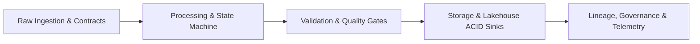

# 🚀 The DataOps, IaC & Platform Engineering Handbook

**Enterprise Reference Architecture, Production Incident Runbooks & 4-Tier Interview Preparation Matrix**

[](https://github.com/santoshjammi29/dataops-cicd-handbook/actions)
[](#)
[](LICENSE)

> Infrastructure as Code, automated data quality gates, Kubernetes for data workloads, and enterprise CI/CD pipelines.  
> Part of the **Modern Data Engineering & Lakehouse Systems Encyclopedia** ecosystem anchored by [**moderndataengineer.uk**](https://moderndataengineer.uk).

[Platform Architecture](#️-platform-architecture) • [Whiteboard Blueprints](#-whiteboard-blueprints) • [Interactive CLI](#-interactive-cli-explorer) • [Architectures](#️-architectural-deep-dives) • [Runbooks](#-production-incident-runbooks) • [Interview Matrix](#-4-tier-interview-preparation-matrix) • [Sister Repositories](#-ecosystem-interlinking--sister-repositories)

---

## 🎯 Overview & Mission

Modern enterprise data systems require rigorous operational governance, predictable failure recovery, deterministic schemas, and observable pipeline execution.

This repository provides **battle-tested production specifications**:
- **4 Deep-Dive Architectural Blueprints**: In-depth engine mechanics, state stores, and Mermaid diagrams.
- **6 Production Incident Disaster Recovery Runbooks**: SEV-1 and SEV-2 playbooks with Emergency Decision Trees.
- **4-Tier Progressive Interview Matrix & 50 Flashcards**: Level 100 to Level 400 questions and active recall deck.
- **52 Whiteboard Blueprints**: Architectural infographics mirrored under `assets/whiteboards/`.
- **Interactive Terminal Shell**: Instant search and study directly from the terminal via `python scripts/interactive_shell.py`.

---

## 🏛️ Platform Architecture



---

## 🖼️ Master Whiteboard Architecture Blueprints

The repository includes **52 publication-grade architectural whiteboard blueprints** mirrored under [`assets/whiteboards/`](assets/whiteboards) and cataloged with comprehensive multi-persona breakdowns, failure modes, and engine internals in [`docs/whiteboard_diagrams/README.md`](docs/whiteboard_diagrams/README.md).

### 📐 Visual Blueprints Showcase

<table>
  <tr>
    <td width="50%" valign="top">
      <a href="docs/whiteboard_diagrams/README.md#apache-airflow-distributed-architecture">
        
      </a>
      <br><strong>Apache Airflow Distributed Production Architecture</strong><br>
      <em>Scheduler heartbeat, Celery/Kubernetes executors, metadata DB, and worker pools.</em>
    </td>
    <td width="50%" valign="top">
      <a href="docs/whiteboard_diagrams/README.md#databricks-dabs-devops-pipeline">
        
      </a>
      <br><strong>Databricks Asset Bundles (DABs) & Serverless CI/CD Architecture</strong><br>
      <em>Declarative bundle YAML, automated validation, and multi-environment promotion.</em>
    </td>
  </tr>
  <tr>
    <td width="50%" valign="top">
      <a href="docs/whiteboard_diagrams/README.md#lakehouse-cicd-promotion-lifecycle">
        
      </a>
      <br><strong>Enterprise Lakehouse CI/CD Multi-Environment Promotion & Rollback Flow</strong><br>
      <em>Slim CI, state-based testing, automated rollbacks, and zero-downtime deployment.</em>
    </td>
    <td width="50%" valign="top">
      <a href="docs/whiteboard_diagrams/README.md#data-quality-wap-quarantine">
        
      </a>
      <br><strong>Data Quality Observability & Write-Audit-Publish (WAP) Circuit Breaker Flow</strong><br>
      <em>Pre-commit data gates, quarantine schemas, and automated circuit breaking.</em>
    </td>
  </tr>
  <tr>
    <td width="50%" valign="top">
      <a href="docs/whiteboard_diagrams/README.md#orchestration-backfill-lifecycle">
        
      </a>
      <br><strong>Pipeline Orchestration Lifecycle, State Machine & Catchup Backfill</strong><br>
      <em>DAG state transitions, retry policies, backfill coordination, and SLA tracking.</em>
    </td>
    <td width="50%" valign="top">
      <a href="docs/whiteboard_diagrams/README.md#lakehouse-finops-cost-optimization">
        
      </a>
      <br><strong>Enterprise Lakehouse FinOps & Cloud Cost Optimization</strong><br>
      <em>System tables query telemetry, cluster rightsizing, and cost attribution.</em>
    </td>
  </tr>
  <tr>
    <td width="50%" valign="top">
      <a href="docs/whiteboard_diagrams/README.md#lakehouse-access-masking-lifecycle">
        
      </a>
      <br><strong>Lakehouse Fine-Grained Access Control, Dynamic Masking & Entra/ABAC Enforcement</strong><br>
      <em>Workload identity federation, OIDC token exchange, and credential isolation.</em>
    </td>
    <td width="50%" valign="top">
      <a href="docs/whiteboard_diagrams/README.md#streaming-dlq-recovery-flow">
        
      </a>
      <br><strong>Stateful Streaming Failure Recovery & Dead-Letter Queue (DLQ) Remediation</strong><br>
      <em>Automated incident triage, alerting integrations, and dead-letter queue routing.</em>
    </td>
  </tr>
</table>

> 🔍 **Explore all 52 blueprints with 5-persona breakdowns, failure modes, and engine internals in [docs/whiteboard_diagrams/README.md](docs/whiteboard_diagrams/README.md)**.

## 💻 Interactive CLI Explorer

Explore architectures, runbooks, and interview guides directly from your terminal:

```bash
# Browse catalog
python scripts/interactive_shell.py --list
python scripts/interactive_shell.py --runbooks
python scripts/interactive_shell.py --architectures
python scripts/interactive_shell.py --interview
python scripts/interactive_shell.py --ecosystem

# Run self-contained test suite
python scripts/run_tests.py
```

---

## 📦 Production Curriculum Modules

| Module | Title & Focus | Key Deliverables & Code |
| :---: | :--- | :--- |
| **01** | **[GitOps & Trunk-Based Development](modules/01_gitops_and_trunk_based_development/README.md)** | Short-lived feature branches, ephemeral PR schemas, automated destruction on merge |
| **02** | **[Declarative Infrastructure as Code (Terraform)](modules/02_declarative_infrastructure_as_code/README.md)** | Lakehouse storage provisioning, remote state locking, drift detection, `terraform/main.tf` |
| **03** | **[Automated Regression Testing & Data-Diff](modules/03_automated_testing_and_data_diff/README.md)** | Value-level diffing between PR staging and production, schema assertion gates, statistical drift |
| **04** | **[Slim CI & Production State Deferral](modules/04_slim_ci_and_state_deferral/README.md)** | Modified node selection (`state:modified+`), GitHub Actions workflow, 85% compute cost reduction |
| **05** | **[Pre-Commit Hooks & Static Analysis](modules/05_pre_commit_linters_and_static_analysis/README.md)** | SQLFluff dialect linting, Ruff for Python, TruffleHog secret scanning, `.pre-commit-config.yaml` |
| **06** | **[Write-Audit-Publish (WAP) & Zero-Downtime Swaps](modules/06_write_audit_publish_and_blue_green/README.md)** | Table branching, automated audit test suites, atomic branch swap, zero-downtime rollback |
| **07** | **[Kubernetes Operators for Distributed Data](modules/07_kubernetes_and_containerized_compute/README.md)** | Spark on K8s Operator, dynamic pod scheduling, spot node reclamation tolerance |
| **08** | **[Keyless Cloud Auth via OIDC Workload Identity](modules/08_secrets_management_and_oidc_workload_identity/README.md)** | Eliminating long-lived credentials, GitHub Actions OIDC federation with AWS/Azure/GCP IAM |
| **09** | **[Data Observability Pillars & OpenLineage](modules/09_observability_sla_alerting_and_telemetry/README.md)** | Freshness, Volume, Schema, Quality, Lineage; Prometheus metrics exporter, SLA alerting |
| **10** | **[Production Incident Severity & Post-Mortems](modules/10_incident_management_and_post_mortem/README.md)** | SEV1-4 classification, on-call escalation, blameless post-mortem template with 5-Whys |

---

## 🏛️ Architectural Deep Dives

Four production-tested architectural specifications located under `architectures/`:

| Spec ID | Document Title | Target Level | Core Architectural Focus |
| :---: | :--- | :---: | :--- |
| **01** | **[Declarative Data Infrastructure as Code (IaC)](architectures/01_declarative_infrastructure_as_code_for_data.md)** | `Level 300-400` | Modular Terraform, Bicep, and Databricks Asset Bundles (DABs) with state locking. |
| **02** | **[Kubernetes Operator Pattern for Data Workloads](architectures/02_kubernetes_operator_pattern_for_data_workloads.md)** | `Level 300-400` | Custom Resource Definitions (CRDs), Spark-on-K8s, and Airflow on Kubernetes. |
| **03** | **[Write-Audit-Publish (WAP) & Automated Quality Gates](architectures/03_automated_data_quality_gates_and_wap.md)** | `Level 300-400` | Branching table commits, pre-merge assertions with Great Expectations/Soda, zero-leak pipelines. |
| **04** | **[Data Observability & Statistical Anomaly Architecture](architectures/04_data_observability_and_statistical_anomaly_detection.md)** | `Level 300-400` | Automated tracking of Freshness, Volume, Schema, and Distribution drift using 3-sigma thresholds. |

---

## 🚨 Production Incident Runbooks

Six operational disaster recovery runbooks located under `runbooks/`:

| Runbook ID | Title & Direct Link | Severity | Root Cause & Remediation Focus |
| :---: | :--- | :---: | :--- |
| **01** | **[Terraform / IaC State Lock & Resource Drift Disaster Recovery](runbooks/01_iac_state_lock_and_drift_disaster_recovery.md)** | `SEV-1` | Release stuck state locks, import out-of-band cloud modifications, and reconcile plan diffs. |
| **02** | **[Failed Production Schema Migration & Emergency Rollback](runbooks/02_production_schema_migration_rollback_triage.md)** | `SEV-1` | Perform zero-downtime rollback of breaking table migrations without dropping consumer data. |
| **03** | **[Data Quality Assertion Gate Failure & Quarantine Triage](runbooks/03_data_quality_assertion_pipeline_blocker_triage.md)** | `SEV-2` | Isolate rejected batch payloads, inspect anomaly scoreboards, and permit emergency overrides. |
| **04** | **[K8s Node Memory Eviction & Data Worker Pod Triage](runbooks/04_kubernetes_node_memory_eviction_and_oom_triage.md)** | `SEV-1` | Diagnose Pod Eviction, OOMKilled, ephemeralkeys, and tuning requests/limits on data nodes. |
| **05** | **[CI/CD Service Principal Compromise & Token Emergency Rotation](runbooks/05_ci_runner_credential_compromise_and_token_rotation.md)** | `SEV-1` | Invalidate GitHub Actions / GitLab CI OIDC credentials and audit recent workflow runs. |
| **06** | **[Observability Alert Fatigue & Threshold Tuning Runbook](runbooks/06_data_observability_alert_fatigue_and_threshold_tuning.md)** | `SEV-2` | Adjust sliding dynamic baseline algorithms, tune anomaly sensitivities, and eliminate alert noise. |

---

## 🎓 4-Tier Interview Preparation Matrix

Comprehensive technical interview guides and flashcard deck located under `interview/`:

| Tier | Role Target | Core Focus Areas | Direct Link |
| :---: | :--- | :--- | :---: |
| **Tier 1** | **DataOps Engineer** | Git branching workflows, Docker containers for data, basic CI/CD actions. | [`01_junior.md`](interview/01_dataops_engineer.md) |
| **Tier 2** | **Platform Engineer** | Terraform modules, Kubernetes deployments, Airflow Helm charts, secrets management. | [`02_mid_level.md`](interview/02_platform_engineer.md) |
| **Tier 3** | **Senior Platform Reliability Engineer** | Observability pipelines, automated rollbacks, WAP pattern, drift detection. | [`03_senior.md`](interview/03_senior_platform_reliability_engineer.md) |
| **Tier 4** | **Staff Data Platform Architect** | Enterprise developer platform (IDP), multi-tenant K8s compute, cost governance. | [`04_staff.md`](interview/04_staff_data_platform_architect.md) |
| **Deck** | **50 Rapid-Fire Flashcards** | 50 active recall questions and answers for technical mastery. | [`05_flashcards.md`](interview/05_flashcards_deck_50.md) |

---

## 🌐 Ecosystem Interlinking & Sister Repositories

The Modern Data Engineering ecosystem is intentionally partitioned into specialized, tightly coupled reference repositories anchored by **[Modern Data Engineer Platform (`moderndataengineer.uk`)](https://github.com/santoshjammi29/moderndataengineer)**:

| Core Engineering Focus | Flagship Repository | Direct Deep-Link Topics & Implementations in Sister Repositories |
| :--- | :--- | :--- |
| **Apache Spark & PySpark Core** | **[The PySpark Handbook](https://github.com/santoshjammi29/pyspark-handbook)** | • **Delta Lake ACID & Liquid Clustering**: [Databricks Handbook Mod 03 & 04](https://github.com/santoshjammi29/databricks-handbook)<br>• **SQL Windowing Equivalents**: [SQL Handbook Mod 04](https://github.com/santoshjammi29/sql-handbook)<br>• **Azure VNet Injection & Fabric Spark**: [Azure Cheat Sheet](https://github.com/santoshjammi29/azure-cheat-sheet) |
| **Databricks Platform** | **[The Databricks Handbook](https://github.com/santoshjammi29/databricks-handbook)** | • **Core PyArrow UDFs & Higher-Order Functions**: [PySpark Handbook Mod 01 & 02](https://github.com/santoshjammi29/pyspark-handbook)<br>• **Databricks SQL vs ANSI Rosetta Stone**: [SQL Handbook Runbook 05](https://github.com/santoshjammi29/sql-handbook)<br>• **Azure Databricks Landing Zones & Bicep IaC**: [Azure Cheat Sheet](https://github.com/santoshjammi29/azure-cheat-sheet) |
| **Relational & Cloud MPP SQL** | **[The SQL Handbook](https://github.com/santoshjammi29/sql-handbook)** | • **Distributed Data Movement & Skew Salting**: [PySpark Runbook 03](https://github.com/santoshjammi29/pyspark-handbook)<br>• **Serverless SQL Warehouse Spill Tuning**: [Databricks Runbook 05](https://github.com/santoshjammi29/databricks-handbook)<br>• **Synapse & Fabric OneLake Direct Lake SQL**: [Azure Architecture 01](https://github.com/santoshjammi29/azure-cheat-sheet) |
| **Enterprise Cloud & Fabric** | **[Azure Enterprise Handbook](https://github.com/santoshjammi29/azure-cheat-sheet)** | • **Databricks Asset Bundles (DABs) & Lakeflow**: [Databricks Handbook Mod 07](https://github.com/santoshjammi29/databricks-handbook)<br>• **Structured Streaming & RocksDB State**: [PySpark Handbook Mod 06](https://github.com/santoshjammi29/pyspark-handbook)<br>• **Cloud Warehouse Cost Hardening**: [SQL Handbook Runbook 06](https://github.com/santoshjammi29/sql-handbook) |
| **Analytics Engineering & dbt** | **[The dbt Handbook](https://github.com/santoshjammi29/dbt-handbook)** | • **Incremental Merge Optimizations**: [SQL Handbook Mod 06](https://github.com/santoshjammi29/sql-handbook)<br>• **dbt on Databricks & Unity Catalog**: [Databricks Handbook Mod 07](https://github.com/santoshjammi29/databricks-handbook)<br>• **Automated WAP Quality Gates**: [DataOps Handbook](https://github.com/santoshjammi29/dataops-cicd-handbook) |
| **Real-Time Streaming** | **[The Streaming Handbook](https://github.com/santoshjammi29/streaming-handbook)** | • **PySpark Structured Streaming & Watermarks**: [PySpark Handbook Mod 06](https://github.com/santoshjammi29/pyspark-handbook)<br>• **Event Hubs & IoT Real-Time Engine**: [Azure Architecture 04](https://github.com/santoshjammi29/azure-cheat-sheet)<br>• **Debezium CDC to Delta Lake**: [Databricks Handbook Mod 04](https://github.com/santoshjammi29/databricks-handbook) |
| **Data Systems Design** | **[Data System Design Handbook](https://github.com/santoshjammi29/data-system-design-handbook)** | • **MPP Distributed Engine Internals**: [SQL Handbook Architecture 02](https://github.com/santoshjammi29/sql-handbook)<br>• **Unified Memory & Catalyst Engine**: [PySpark Architecture 01 & 02](https://github.com/santoshjammi29/pyspark-handbook)<br>• **Zero-Trust Enterprise Landing Zones**: [Azure Architecture 02](https://github.com/santoshjammi29/azure-cheat-sheet) |
| **DataOps & Platform CI/CD** | **[DataOps & Platform Handbook](https://github.com/santoshjammi29/dataops-cicd-handbook)** | • **Databricks Asset Bundles (DABs) IaC**: [Databricks Handbook Mod 07](https://github.com/santoshjammi29/databricks-handbook)<br>• **Azure Bicep IaC & GitHub Actions OIDC**: [Azure Cheatsheet](https://github.com/santoshjammi29/azure-cheat-sheet)<br>• **dbt Slim CI & State Deferral**: [dbt Handbook](https://github.com/santoshjammi29/dbt-handbook) |
| **Unified Web Platform** | **[Modern Data Engineer Hub](https://github.com/santoshjammi29/moderndataengineer)** | • **Interactive Simulators & 52 Blueprints**: [Live Platform (`moderndataengineer.uk`)](https://moderndataengineer.uk)<br>• **Google-Grade BM25F Search & Virtual DOM**: [Architecture Spec](https://github.com/santoshjammi29/moderndataengineer/blob/main/docs/STANDARDIZED_ARCHITECTURE.md) |


---

## 📜 License

Distributed under the **[MIT License](LICENSE)**. Maintained with ❤️ by [Santosh Jammi](https://github.com/santoshjammi29) (2026).
