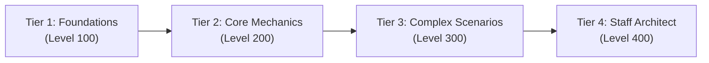

# 🗺️ DataOps & CI/CD Handbook — Interactive Curriculum Roadmap

> **Interactive Checkbox Study Tracker & Mastery Progression**  
> **Canonical Repository**: [santoshjammi29/dataops-cicd-handbook](https://github.com/santoshjammi29/dataops-cicd-handbook) | **Ecosystem**: [moderndataengineer.uk](https://moderndataengineer.uk)  
> **Total Exercises & Drills**: `21` | **Primary Pillar**: `Apache Airflow & Orchestration`

---

## How to Use This Roadmap

1. **Fork this repository** to your personal GitHub account.
2. Work through the modules in sequence or target specific architectural topics.
3. Check off boxes (`- [x]`) as you complete each exercise, drill, or notebook.
4. Commit and push your progress to your personal branch to track your career journey!

```
Progress: [ ] 0 / 21 Completed (0.0%)
```

---

## Curriculum Structure: The 4 Mastery Tiers



### 🟡 Tier 2: Core Mechanics & Implementation (Level 200)
> Production pipeline patterns, schema validation, standard transformations, and unit tests.

- [ ] `dataops-cicd-handbook-01_gitops_and_trunk_based_development` — [Gitops And Trunk Based Development](modules/01_gitops_and_trunk_based_development/README.md) `Level 200`
- [ ] `dataops-cicd-handbook-02_declarative_infrastructure_as_code` — [Declarative Infrastructure As Code](modules/02_declarative_infrastructure_as_code/README.md) `Level 200`
- [ ] `dataops-cicd-handbook-03_automated_testing_and_data_diff` — [Automated Testing And Data Diff](modules/03_automated_testing_and_data_diff/README.md) `Level 200`
- [ ] `dataops-cicd-handbook-04_slim_ci_and_state_deferral` — [Slim Ci And State Deferral](modules/04_slim_ci_and_state_deferral/README.md) `Level 200`
- [ ] `dataops-cicd-handbook-05_pre_commit_linters_and_static_analysis` — [Pre Commit Linters And Static Analysis](modules/05_pre_commit_linters_and_static_analysis/README.md) `Level 200`
- [ ] `dataops-cicd-handbook-06_write_audit_publish_and_blue_green` — [Write Audit Publish And Blue Green](modules/06_write_audit_publish_and_blue_green/README.md) `Level 200`
- [ ] `dataops-cicd-handbook-07_kubernetes_and_containerized_compute` — [Kubernetes And Containerized Compute](modules/07_kubernetes_and_containerized_compute/README.md) `Level 200`
- [ ] `dataops-cicd-handbook-08_secrets_management_and_oidc_workload_identity` — [Secrets Management And Oidc Workload Identity](modules/08_secrets_management_and_oidc_workload_identity/README.md) `Level 200`
- [ ] `dataops-cicd-handbook-09_observability_sla_alerting_and_telemetry` — [Observability Sla Alerting And Telemetry](modules/09_observability_sla_alerting_and_telemetry/README.md) `Level 200`
- [ ] `dataops-cicd-handbook-10_incident_management_and_post_mortem` — [Incident Management And Post Mortem](modules/10_incident_management_and_post_mortem/README.md) `Level 200`
- [ ] `dataops-cicd-handbook-curriculum-topics` — [Topics Directory: DataOps & CI/CD Handbook](topics/README.md) `Level 200`

### 🔴 Tier 4: Production Hardening, FinOps & Staff Architecture (Level 400)
> Enterprise trade-offs, cross-cloud DR, zero-trust security, and FinOps cost optimization.

- [ ] `dataops-cicd-handbook-rb-01_iac_state_lock_and_drift_disaster_recovery` — [Incident Runbook: Iac State Lock And Drift Disaster Recovery](runbooks/01_iac_state_lock_and_drift_disaster_recovery.md) `Level 400`
- [ ] `dataops-cicd-handbook-rb-02_production_schema_migration_rollback_triage` — [Incident Runbook: Production Schema Migration Rollback Triage](runbooks/02_production_schema_migration_rollback_triage.md) `Level 400`
- [ ] `dataops-cicd-handbook-rb-03_data_quality_assertion_pipeline_blocker_triage` — [Incident Runbook: Data Quality Assertion Pipeline Blocker Triage](runbooks/03_data_quality_assertion_pipeline_blocker_triage.md) `Level 400`
- [ ] `dataops-cicd-handbook-rb-04_kubernetes_node_memory_eviction_and_oom_triage` — [Incident Runbook: Kubernetes Node Memory Eviction And Oom Triage](runbooks/04_kubernetes_node_memory_eviction_and_oom_triage.md) `Level 400`
- [ ] `dataops-cicd-handbook-rb-05_ci_runner_credential_compromise_and_token_rotation` — [Incident Runbook: Ci Runner Credential Compromise And Token Rotation](runbooks/05_ci_runner_credential_compromise_and_token_rotation.md) `Level 400`
- [ ] `dataops-cicd-handbook-rb-06_data_observability_alert_fatigue_and_threshold_tuning` — [Incident Runbook: Data Observability Alert Fatigue And Threshold Tuning](runbooks/06_data_observability_alert_fatigue_and_threshold_tuning.md) `Level 400`
- [ ] `dataops-cicd-handbook-doc-01_declarative_infrastructure_as_code_for_data` — [Architecture: 01 Declarative Infrastructure As Code For Data](architectures/01_declarative_infrastructure_as_code_for_data.md) `Level 400`
- [ ] `dataops-cicd-handbook-doc-02_kubernetes_operator_pattern_for_data_workloads` — [Architecture: 02 Kubernetes Operator Pattern For Data Workloads](architectures/02_kubernetes_operator_pattern_for_data_workloads.md) `Level 400`
- [ ] `dataops-cicd-handbook-doc-03_automated_data_quality_gates_and_wap` — [Architecture: 03 Automated Data Quality Gates And Wap](architectures/03_automated_data_quality_gates_and_wap.md) `Level 400`
- [ ] `dataops-cicd-handbook-doc-04_data_observability_and_statistical_anomaly_detection` — [Architecture: 04 Data Observability And Statistical Anomaly Detection](architectures/04_data_observability_and_statistical_anomaly_detection.md) `Level 400`

---

## Suggested Study Schedules

| Schedule | Pace | Target Audience | Focus |
|---|---|---|---|
| **4-Week Sprint** | 5-6 drills / day | Interview Prep / Fast Track | Focus on Tier 2 & Tier 3 core drills |
| **8-Week Deep-Dive** | 2-3 drills / day | Full Technical Mastery | Complete all 21 exercises + tests |
| **12-Week Staff Track** | 1-2 drills / day | Architect & Tech Lead | Deep dive into Tier 3 & Tier 4 blueprints |

---

## Sister Repositories & Ecosystem Roadmaps

Explore interactive roadmaps across all 14 pillars of the lakehouse ecosystem:
- [Modern Data Engineer Central Hub](https://moderndataengineer.uk)
- [Databricks Handbook](https://github.com/santoshjammi29/databricks-handbook)
- [PySpark Handbook](https://github.com/santoshjammi29/pyspark-handbook)
- [SQL Handbook](https://github.com/santoshjammi29/sql-handbook)
- [dbt Handbook](https://github.com/santoshjammi29/dbt-handbook)
- [Streaming Handbook](https://github.com/santoshjammi29/streaming-handbook)
- [DataOps & CI/CD Handbook](https://github.com/santoshjammi29/dataops-cicd-handbook)
- [System Design Handbook](https://github.com/santoshjammi29/data-system-design-handbook)
- [Interview Handbook](https://github.com/santoshjammi29/data-engineering-interview-handbook)
- [Security Handbook](https://github.com/santoshjammi29/security-handbook)
