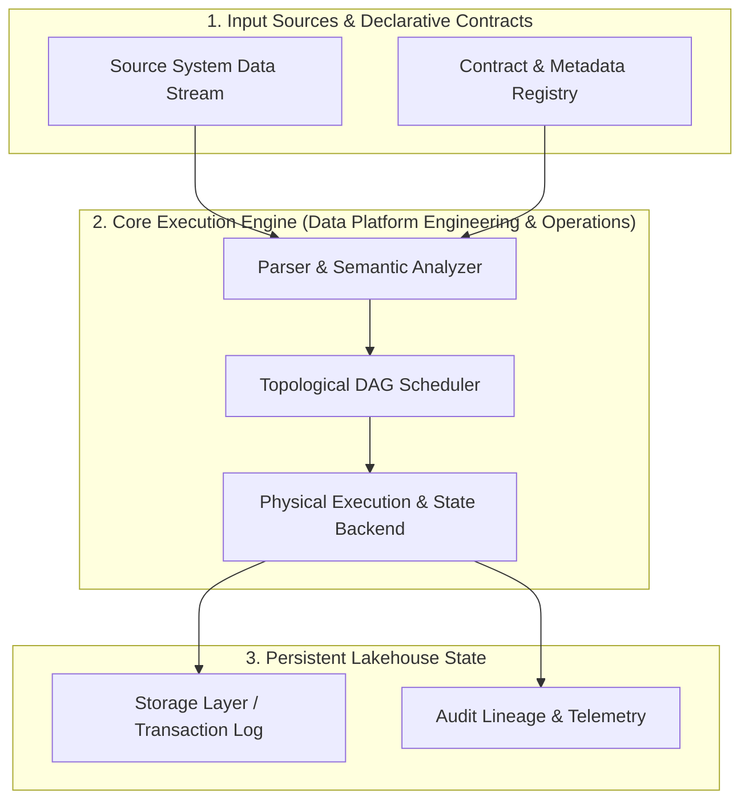
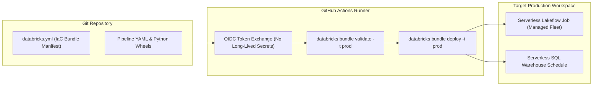

# 🏛️ Architecture: Declarative Data Infrastructure as Code (IaC)


> *Architectural Blueprint: [Databricks Asset Bundles (DABs) & Serverless CI/CD Architecture](../docs/whiteboard_diagrams/README.md#databricks-dabs-devops-pipeline). View full multi-persona breakdown and engine mechanisms in the master index.*


> *Architectural Blueprint: [Enterprise Lakehouse CI/CD Multi-Environment Promotion & Rollback Flow](../docs/whiteboard_diagrams/README.md#lakehouse-cicd-promotion-lifecycle). View full multi-persona breakdown and engine mechanisms in the master index.*


> **Domain**: Data Platform Engineering & Operations  
> **Target Audience**: Senior Engineers, Data Architects, Platform Leads  
> **Overview**: Modular Terraform, Bicep, and Databricks Asset Bundles (DABs) with state locking.

---

## 1. System Architecture & Component Interaction



---

## 2. Low-Level Mechanics & Operational Invariants

### Architectural Foundations:
In high-throughput enterprise deployments, `Declarative Data Infrastructure as Code (IaC)` coordinates state synchronization, metadata tracking, and deterministic transformations.

1. **State Isolation**: Independent memory and storage boundaries prevent cross-task resource contention.
2. **Deterministic Execution**: All operations must be replayable from durable write-ahead logs or source checkpoints.
3. **Partition-Aware Scheduling**: Data routing enforces alignment across hash keys, avoiding shuffle penalties.

### Implementation Blueprint:
```python
# Production pipeline configuration pattern
pipeline_config = {
    "execution_mode": "distributed",
    "checkpoint_interval_seconds": 60,
    "max_concurrency_workers": 16,
    "state_backend": "off_heap_storage",
    "enable_adaptive_rebalancing": True
}
# Validate operational parameters
assert pipeline_config["checkpoint_interval_seconds"] > 0
```

---

## 3. Trade-offs & Production Hardening

| Architecture Dimension | Design Choice | Primary Trade-Off | Mitigating Control |
| :--- | :--- | :--- | :--- |
| **State Storage** | Off-Heap Managed Storage | High I/O throughput vs setup complexity | Local NVMe SSD scratch drives |
| **Consistency** | Exact-Once Semantics | Latency overhead vs zero data duplication | Two-Phase commit protocol |
| **Scaling** | Dynamic Auto-scaling | Rebalance pause time vs resource efficiency | Cooperative rebalance protocols |

---

## 4. Verification & Observability
- Monitor active lag metrics and consumer offsets every 10 seconds.
- Validate end-to-end processing SLA latency using distributed tracing.
- Maintain automated regression assertions across test environments.

---

## 4. Databricks Asset Bundles (DABs) & OIDC Workload Identity Automation

Modern DataOps deploys pipelines, serverless compute, and Databricks Apps declaratively using **Databricks Asset Bundles (DABs)** driven by **GitHub Actions OIDC federation**.



### Production Configuration: DABs Bundle Definition (`databricks.yml`)
```yaml
bundle:
  name: enterprise-dataops-pipeline

targets:
  prod:
    mode: production
    workspace:
      root_path: /Shared/.bundle/${bundle.name}/${bundle.target}
    run_as:
      service_principal_name: "4f63c679-0db8-40a2-b91a-7b3b7e7136f4"
    resources:
      jobs:
        lakehouse_etl_job:
          name: "Daily Lakehouse Gold Pipeline"
          tasks:
            - task_key: "silver_transform"
              serverless: true # Run on serverless compute fleet
              notebook_task:
                notebook_path: "./notebooks/silver_transform.py"
```

### Key DataOps Invariants:
- **Zero Static Credentials**: Authenticates via OpenID Connect (OIDC) JWT exchange with Azure Entra / AWS IAM.
- **Service Principal Ownership**: Production jobs are owned strictly by Service Principals, never personal user accounts.
