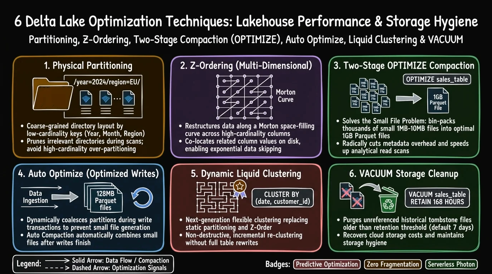
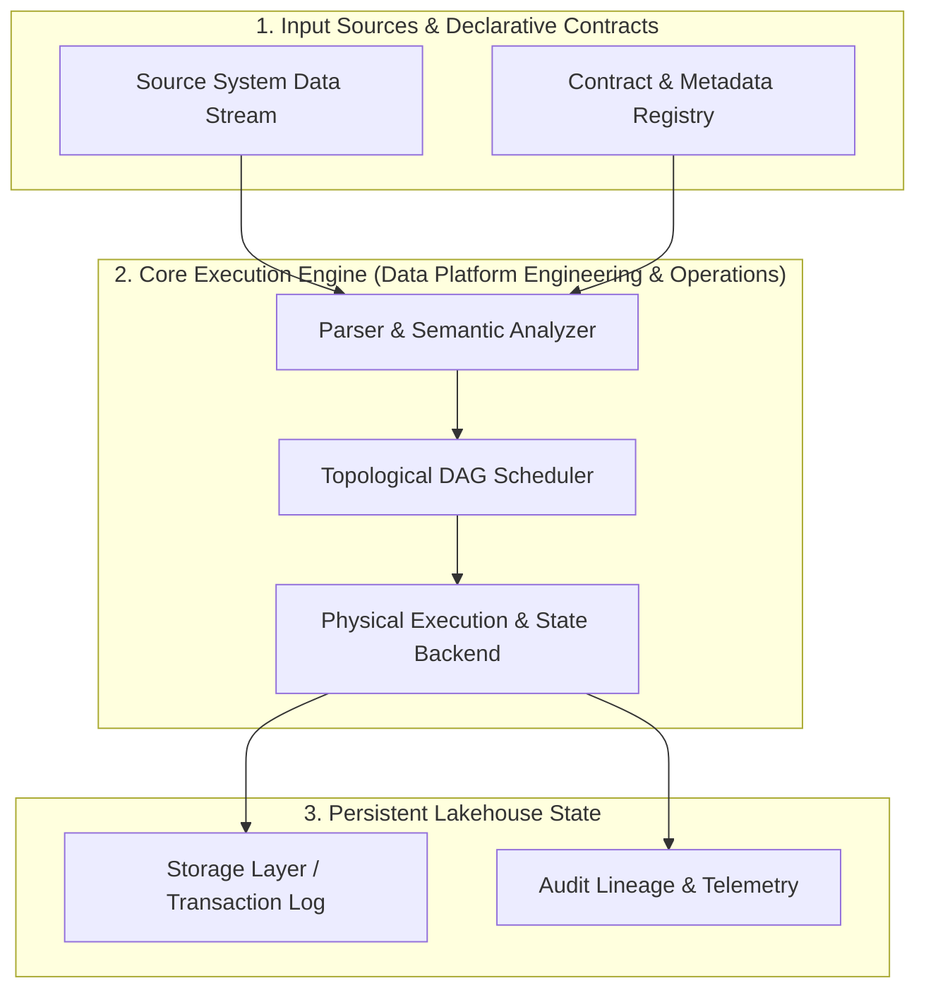
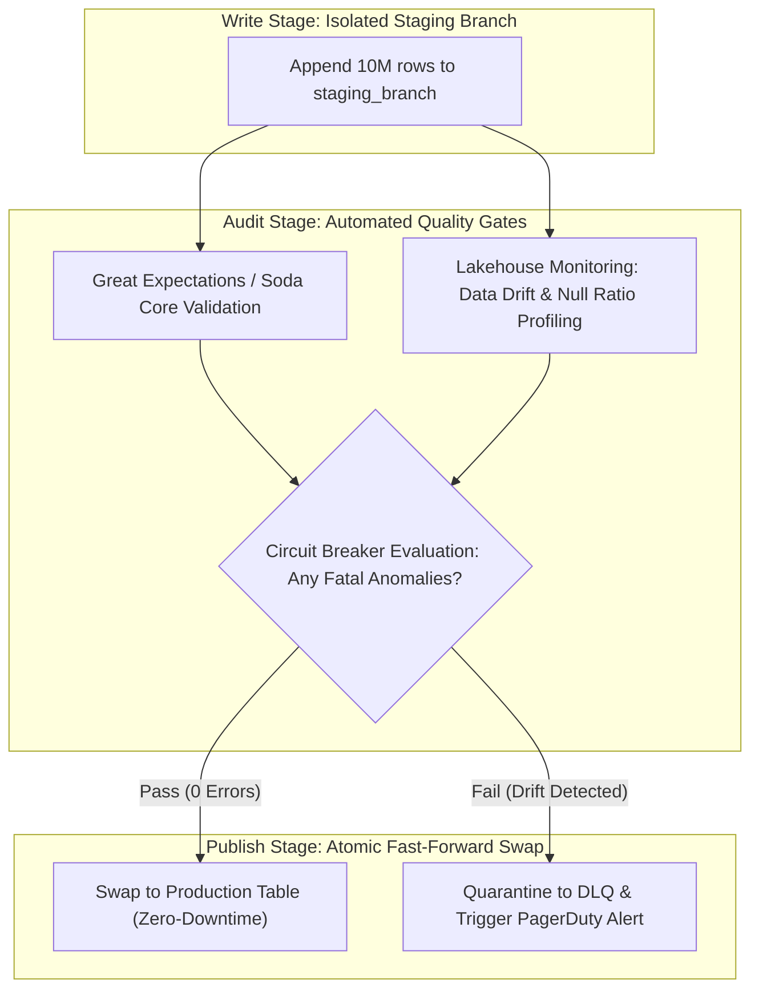

# 🏛️ Architecture: Write-Audit-Publish (WAP) & Automated Quality Gates


> *Architectural Blueprint: [Data Quality Observability & Write-Audit-Publish (WAP) Circuit Breaker Flow](../docs/whiteboard_diagrams/README.md#data-quality-wap-quarantine). View full multi-persona breakdown and engine mechanisms in the master index.*



> *Architectural Blueprint: [6 Delta Lake Optimization Techniques: Lakehouse Performance & Storage Hygiene](../docs/whiteboard_diagrams/README.md#databricks-optimization-techniques-architecture). View full multi-persona breakdown and engine mechanisms in the master index.*


> **Domain**: Data Platform Engineering & Operations  
> **Target Audience**: Senior Engineers, Data Architects, Platform Leads  
> **Overview**: Branching table commits, pre-merge assertions with Great Expectations/Soda, zero-leak pipelines.

---

## 1. System Architecture & Component Interaction



---

## 2. Low-Level Mechanics & Operational Invariants

### Architectural Foundations:
In high-throughput enterprise deployments, `Write-Audit-Publish (WAP) & Automated Quality Gates` coordinates state synchronization, metadata tracking, and deterministic transformations.

1. **State Isolation**: Independent memory and storage boundaries prevent cross-task resource contention.
2. **Deterministic Execution**: All operations must be replayable from durable write-ahead logs or source checkpoints.
3. **Partition-Aware Scheduling**: Data routing enforces alignment across hash keys, avoiding shuffle penalties.

### Implementation Blueprint:
```python
# Production pipeline configuration pattern
pipeline_config = {
    "execution_mode": "distributed",
    "checkpoint_interval_seconds": 60,
    "max_concurrency_workers": 16,
    "state_backend": "off_heap_storage",
    "enable_adaptive_rebalancing": True
}
# Validate operational parameters
assert pipeline_config["checkpoint_interval_seconds"] > 0
```

---

## 3. Trade-offs & Production Hardening

| Architecture Dimension | Design Choice | Primary Trade-Off | Mitigating Control |
| :--- | :--- | :--- | :--- |
| **State Storage** | Off-Heap Managed Storage | High I/O throughput vs setup complexity | Local NVMe SSD scratch drives |
| **Consistency** | Exact-Once Semantics | Latency overhead vs zero data duplication | Two-Phase commit protocol |
| **Scaling** | Dynamic Auto-scaling | Rebalance pause time vs resource efficiency | Cooperative rebalance protocols |

---

## 4. Verification & Observability
- Monitor active lag metrics and consumer offsets every 10 seconds.
- Validate end-to-end processing SLA latency using distributed tracing.
- Maintain automated regression assertions across test environments.

---

## 4. Automated Lakehouse Monitoring & Circuit-Breaker Quarantine Promotion

Enterprise DataOps pairs Write-Audit-Publish (WAP) with **Lakehouse Monitoring**, running automated profiling and drift detection directly inside the staging circuit breaker.



### Production Implementation: Lakehouse Monitoring Circuit Breaker in PySpark
```python
# Create automated quality profile on staging table
from pyspark.sql import functions as F

staging_df = spark.read.table("prod_catalog.staging.orders_branch")

# Audit assertions: check null thresholds and schema constraints
null_rate = staging_df.filter(F.col("customer_id").isNull()).count() / staging_df.count()

if null_rate > 0.001: # Strict 0.1% null ceiling
    raise ValueError(f"Circuit Breaker Tripped! Customer ID null rate: {null_rate:.4f}")

# Publish atomically upon zero anomalies
spark.sql("ALTER TABLE prod_catalog.gold.orders CLONE prod_catalog.staging.orders_branch")
```

### Key Quality Invariants:
- **Fail-Closed Promotion**: If any test fails or data drift exceeds statistical bounds, the pipeline halts immediately without polluting gold tables.
- **Traceable Audit Log**: Validation summaries are written to `system.lakehouse_monitoring` for compliance auditing.
