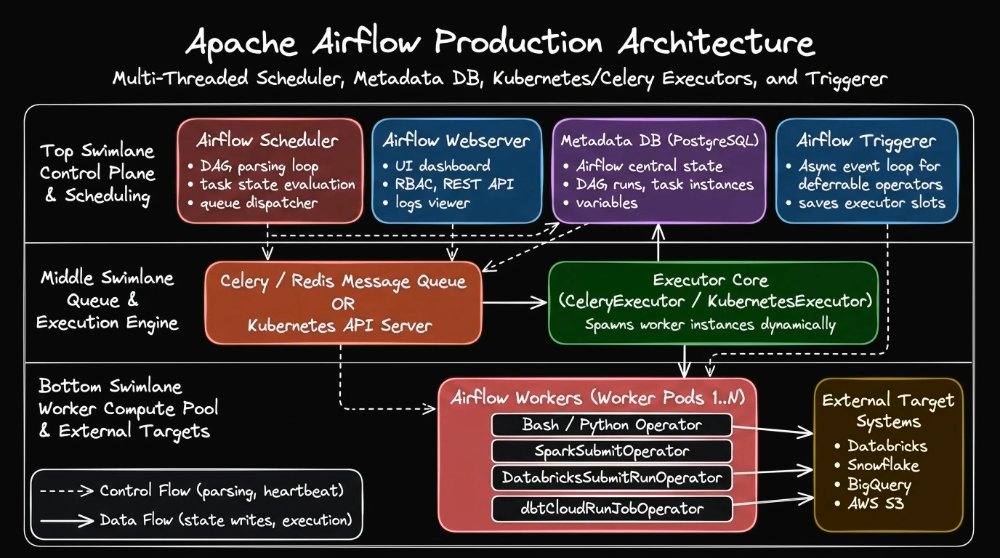

# Module 07: Kubernetes Operators for Distributed Data (Spark on K8s)

> *Architectural Blueprint: [Apache Airflow Distributed Production Architecture](../../docs/whiteboard_diagrams/README.md#apache-airflow-distributed-architecture). View full multi-persona breakdown and engine mechanisms in the master index.*

## 1. Spark on Kubernetes Operator
The Kubernetes Operator eliminates dedicated standalone Spark clusters:
- Driver and Executor pods are scheduled dynamically on demand.
- Spot node tolerance with graceful decommissioning prevents job failure during node reclamation.
