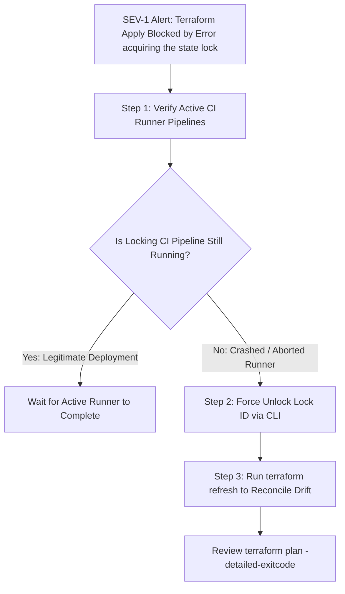

# 🚨 Production Runbook 01: Terraform State Lock Deadlock & Drift Disaster Recovery

> **Incident Severity**: `SEV-1`  
> **Domain**: Infrastructure as Code & Cloud Platform Engineering  
> **Target Systems**: Terraform / OpenTofu, AWS S3 / DynamoDB, Azure Blob Storage  
> **Objective**: Safely release deadlocked Terraform state locks, detect out-of-band resource drift, and restore CI/CD deployments.

---

## 1. Emergency Decision Tree



---

## 2. Immediate Diagnostic Procedures (First 5 Minutes)

### Step 1: Query Error Output for Lock ID and Locking Identity
```bash
# Extract Lock ID from CI error message
grep -A 5 "Error acquiring the state lock" /var/log/terraform/run.log
```

### Step 2: Query DynamoDB Lock Table or Azure Blob Lease
```bash
# AWS DynamoDB: Check lock item
aws dynamodb get-item   --table-name "terraform-state-lock"   --key '{"LockID": {"S": "prod-lakehouse/terraform.tfstate"}}'
```

---

## 3. Root Cause Analysis & Production Remediation

### Production Force Unlock & Safe Drift Reconciliation
```bash
# 1. Release orphaned state lock using the exact LockID from error output
terraform force-unlock -force "9c8a4d2e-3f1b-4a5c-8d7e-9f0a1b2c3d4e"

# 2. Refresh state to detect any out-of-band portal changes
terraform refresh

# 3. Generate detailed execution plan
terraform plan -out=tfplan.binary -detailed-exitcode
```

---

## 4. Verification & Prevention
- [ ] Confirm `terraform plan` executes without state lock contention.
- [ ] Ensure CI runners configure job timeouts ($\le 60	ext{ minutes}$) to prevent orphaned leases.
