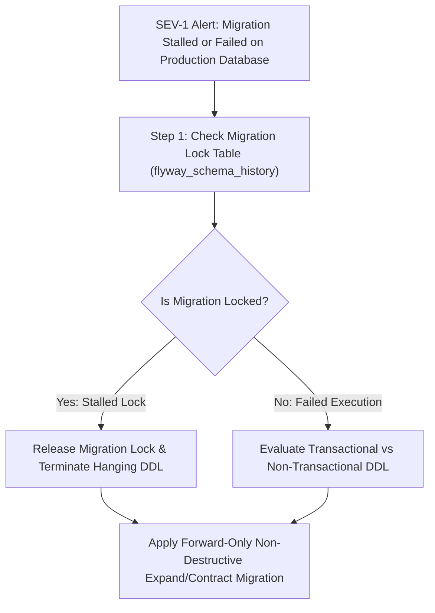

# 🚨 Production Runbook 02: Database Schema Migration Rollback & Lock Triage

> **Incident Severity**: `SEV-1`  
> **Domain**: DataOps & Relational Schema Migrations  
> **Target Systems**: PostgreSQL, MySQL, Flyway, Liquibase, Alembic  
> **Objective**: Clear failed migration locks, revert non-breaking DDL, and apply forward-only recovery.

---

## 1. Emergency Decision Tree



---

## 2. Immediate Diagnostic Procedures (First 5 Minutes)

### Step 1: Query Migration History Table for Failed Scripts
```sql
-- Flyway: Inspect latest failed migration
SELECT installed_rank, version, description, type, script, installed_by, installed_on, execution_time, success
FROM flyway_schema_history
ORDER BY installed_rank DESC
LIMIT 5;
```

---

## 3. Root Cause Analysis & Production Remediation

### Production Expand / Contract Migration Pattern
```sql
-- Phase 1: Expand (Add new nullable column, do NOT drop old column)
ALTER TABLE customers ADD COLUMN phone_e164 VARCHAR(32);

-- Phase 2: Dual Write (Application writes to both phone and phone_e164)
-- Phase 3: Backfill historical data in batches
UPDATE customers SET phone_e164 = phone WHERE phone_e164 IS NULL;

-- Phase 4: Contract (Drop old column after all consumers migrated)
-- ALTER TABLE customers DROP COLUMN phone;
```

---

## 4. Verification & Prevention
- [ ] Run `flyway repair` to align schema checksums.
- [ ] Never execute destructive DDL (`DROP COLUMN`, `ALTER TYPE`) in single-step migrations.
