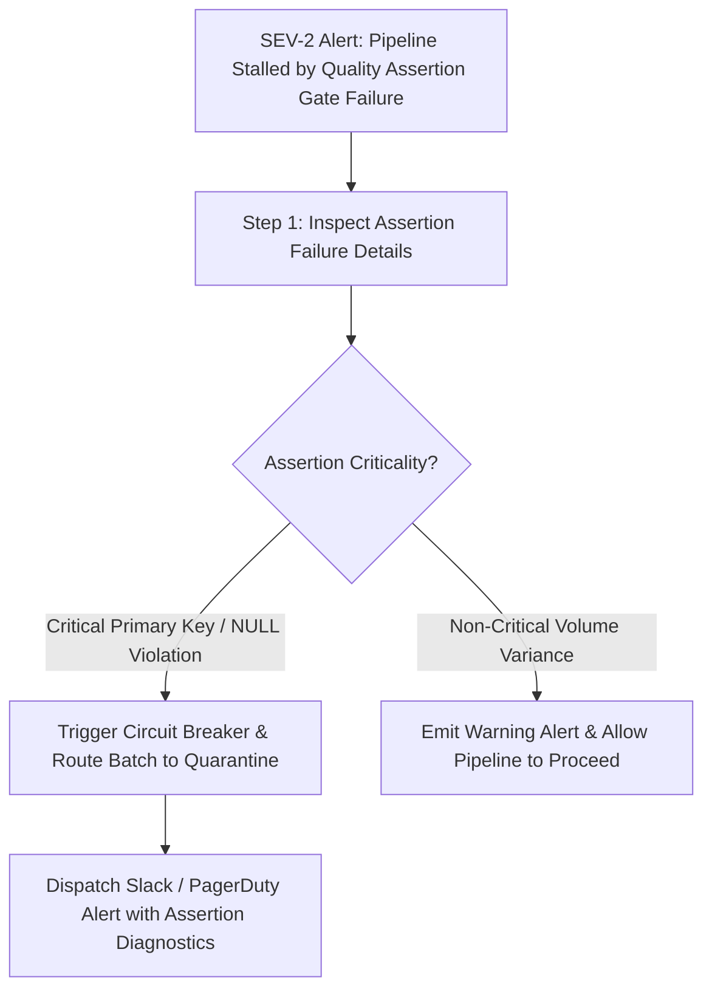

# 🚨 Production Runbook 03: Data Quality Assertion Pipeline Blocker & Circuit Breaker

> **Incident Severity**: `SEV-2`  
> **Domain**: Data Quality Observability & Pipeline Orchestration  
> **Target Systems**: Apache Airflow 2/3, Great Expectations, Soda Core, Delta Live Tables  
> **Objective**: Triage failed data quality assertion gates without allowing corrupted data to pollute Gold marts.

---

## 1. Emergency Decision Tree



---

## 2. Immediate Diagnostic Procedures (First 5 Minutes)

### Step 1: Check Failed Task Assertion Report
```bash
# Query Airflow task logs for quality failure details
airflow tasks logs <DAG_ID> <TASK_ID> <EXECUTION_DATE> | grep -E "QualityAssertionError|Validation Failed"
```

---

## 3. Root Cause Analysis & Production Remediation

### Production Airflow Circuit Breaker Task with Slack Notification
```python
from airflow.decorators import task
from airflow.exceptions import AirflowFailException
import requests

@task
def validate_silver_dataset(df):
    null_count = df.filter(df["order_id"].isNull()).count()
    total_count = df.count()

    if null_count > 0:
        error_msg = f"❌ Quality Assertion Failed: Found {null_count} NULL order_ids out of {total_count} records."
        # Trigger Slack alert
        requests.post("https://hooks.slack.com/services/T00/B00/X00", json={"text": error_msg})
        raise AirflowFailException(error_msg)

    return df
```

---

## 4. Verification & Prevention
- [ ] Confirm corrupted batch is safely isolated in quarantine table `silver_orders_quarantine`.
- [ ] Verify downstream Gold aggregations did not consume bad records.
