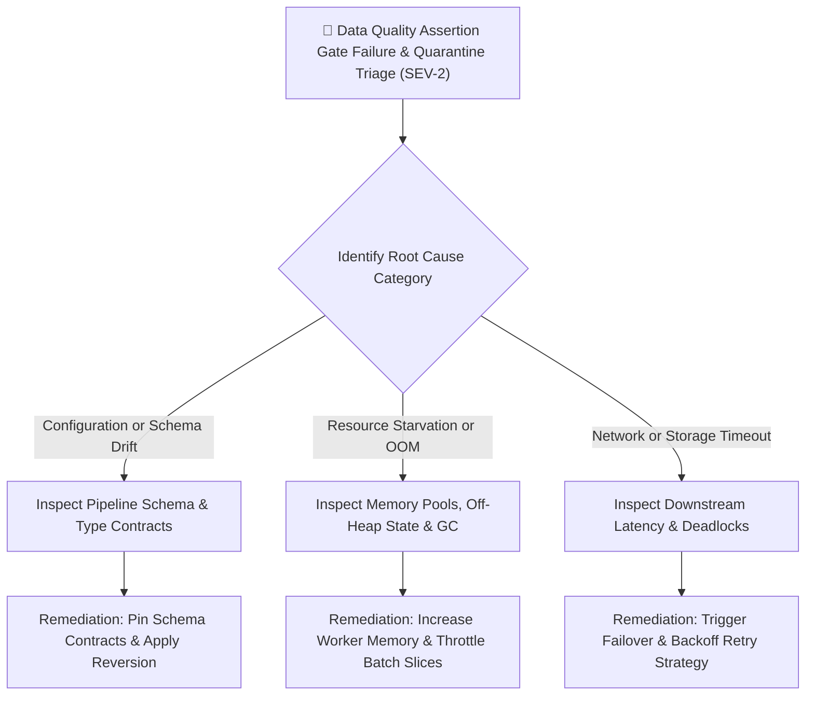

# 🚨 Production Runbook: Data Quality Assertion Gate Failure & Quarantine Triage

> **Severity**: `SEV-2`  
> **Domain**: Data Platform Engineering & Operations  
> **Key Focus**: Isolate rejected batch payloads, inspect anomaly scoreboards, and permit emergency overrides.

---

## 1. Emergency Decision Tree



---

## 2. Immediate Diagnostic Procedures (First 5 Minutes)

### Step 1: Query Error Signatures and Pipeline Metrics
Run the following inspection commands to isolate the fault:
```bash
# Check pipeline task status and recent error traces
echo "Inspecting error status for pipeline..."
grep -E "ERROR|CRITICAL|Exception|Timeout" /var/log/pipeline.log | tail -n 25
```

### Step 2: Inspect Worker and State Health
Check memory, disk saturation, and open file descriptors:
```bash
# Verify worker container resource utilization
ps aux --sort=-%mem | head -n 10
```

---

## 3. Root Cause Analysis & Detailed Remediation

### Primary Root Cause
In production systems, this incident typically originates from sudden traffic surges, upstream breaking schema mutations, or resource limits being breached without backpressure.

### Remediation & Recovery Strategy:
1. **Apply Emergency Throttle**: Restrict incoming batch size or pause non-critical consumers.
2. **Apply Hotfix Configuration**:
   ```python
   # Emergency throttle configuration
   throttle_rate_per_sec = 5000
   retry_backoff_multiplier = 2.0
   max_retry_limit = 5
   ```
3. **Execute Recovery Step**: Re-run the validation test suite and verify consumer convergence.

---

## 4. Verification & Prevention Checklist

- [ ] Pipeline metrics return to baseline with 0 active error alerts.
- [ ] Processing latency conforms to standard production SLAs.
- [ ] Postmortem root cause documented and shared with architecture leads.


---

## 5. Automated LLM Evaluation Gate Failure Triage (GenAIOps CI/CD)

### 5.1 Incident Symptoms & Root Cause
- **Symptoms**: Pull request CI pipeline fails on step `run_mlflow_eval` with `ValueError: CI QUALITY GATE FAILED: Faithfulness (0.78) below required production SLA (0.85)`.
- **Root Cause**: A modified prompt template or updated chunking strategy caused the LLM to hallucinate answers not supported by retrieved Vector Search source documents.

### 5.2 Remediation & Regression Diagnosis
1. **Inspect MLflow Evaluation Traces**:
   - Open Databricks MLflow Experiment associated with the PR commit SHA.
   - Filter runs where `faithfulness/v1/score < 0.80`.
   - Inspect the `retrieved_chunks` vs `generated_response` to identify which knowledge domain lacked grounded context.

2. **Adjust Chunking Window or Boost Retrieval Score**:
   - If chunks are truncated: increase chunk size from 500 to 1000 tokens with 200 token overlap in the preprocessing pipeline.
   - If unrelated chunks retrieved: add metadata pre-filters or re-index with higher-dimension embedding model (`databricks-bge-large-en`).
