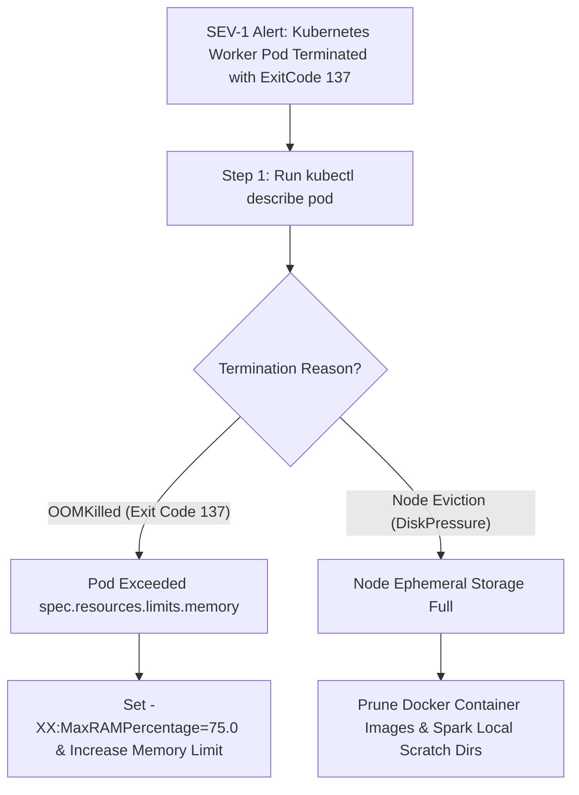

# 🚨 Production Runbook 04: Kubernetes Worker OOMKilled & Pod Eviction Triage

> **Incident Severity**: `SEV-1`  
> **Domain**: Kubernetes & Distributed Data Infrastructure  
> **Target Systems**: Kubernetes Cluster (EKS / AKS / GKE), Airflow Celery/K8s Workers, Spark on K8s  
> **Objective**: Diagnose Exit Code 137 (OOMKilled) pod crashes and configure JVM cgroup memory caps.

---

## 1. Emergency Decision Tree



---

## 2. Immediate Diagnostic Procedures (First 5 Minutes)

### Step 1: Inspect Pod Last Termination State
```bash
kubectl describe pod <pod-name> -n airflow | grep -A 8 "Last State"
```

---

## 3. Root Cause Analysis & Production Remediation

### Production Kubernetes Pod Configuration with JVM CGroup Support
```yaml
apiVersion: v1
kind: Pod
metadata:
  name: airflow-worker-pod
spec:
  containers:
    - name: worker
      image: apache/airflow:2.9.1-python3.11
      env:
        - name: JAVA_TOOL_OPTIONS
          value: "-XX:+UseContainerSupport -XX:MaxRAMPercentage=75.0 -XX:+ExitOnOutOfMemoryError"
      resources:
        requests:
          memory: "4Gi"
          cpu: "2"
        limits:
          memory: "8Gi"
          cpu: "4"
```

---

## 4. Verification & Prevention
- [ ] Verify worker pod stabilizes and does not restart during peak batch transformations.
- [ ] Set Grafana alert on `container_memory_usage_bytes / container_spec_memory_limit_bytes > 0.85`.
