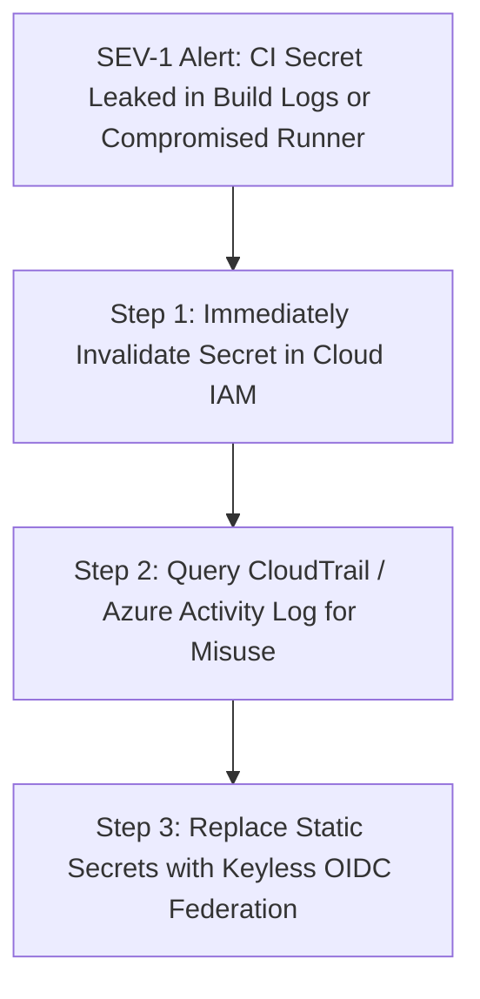

# 🚨 Production Runbook 05: CI Runner Credential Compromise & Keyless OIDC Migration

> **Incident Severity**: `SEV-1`  
> **Domain**: DevSecOps & Supply Chain Security  
> **Target Systems**: GitHub Actions, AWS IAM, Azure Entra ID, HashiCorp Vault  
> **Objective**: Invalidate compromised long-lived CI service account keys and enforce keyless OIDC workload identity.

---

## 1. Emergency Decision Tree



---

## 2. Immediate Diagnostic Procedures (First 5 Minutes)

### Step 1: Invalidate Leaked Azure Service Principal Key
```bash
az ad app credential delete --id <CLIENT_ID> --key-id <KEY_ID>
```

---

## 3. Root Cause Analysis & Production Remediation

### Production GitHub Actions Keyless OIDC Workflow
```yaml
name: Deploy Data Pipelines
on:
  push:
    branches: [main]

permissions:
  id-token: write
  contents: read

jobs:
  deploy:
    runs-on: ubuntu-latest
    steps:
      - uses: actions/checkout@v4
      - name: Azure OIDC Login
        uses: azure/login@v2
        with:
          client-id: ${{ secrets.AZURE_CLIENT_ID }}
          tenant-id: ${{ secrets.AZURE_TENANT_ID }}
          subscription-id: ${{ secrets.AZURE_SUBSCRIPTION_ID }}
```

---

## 4. Verification & Prevention
- [ ] Confirm no long-lived static secret keys exist in repository secrets.
- [ ] Verify Azure federated credential trust is bound strictly to `repo:<org>/<repo>:ref:refs/heads/main`.
