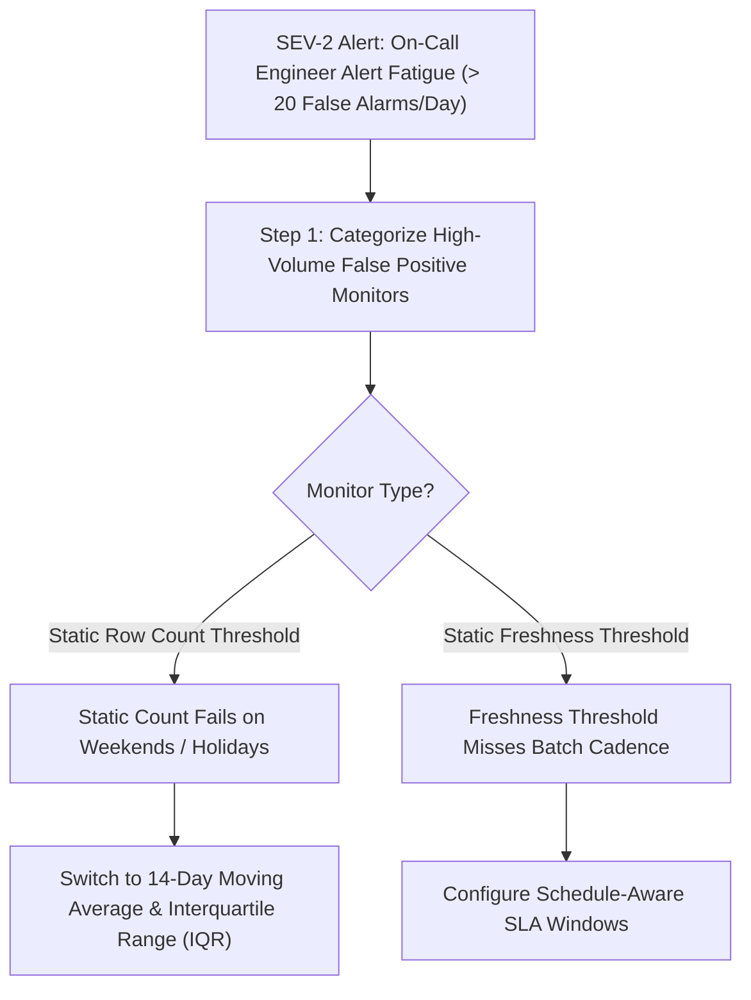

# 🚨 Production Runbook 06: Data Observability Alert Fatigue & Dynamic Threshold Tuning

> **Incident Severity**: `SEV-2`  
> **Domain**: Data Observability & Monitoring  
> **Target Systems**: Datadog, Prometheus, Monte Carlo, Elementary  
> **Objective**: Replace brittle static threshold monitors with dynamic statistical anomaly detection.

---

## 1. Emergency Decision Tree



---

## 2. Immediate Diagnostic Procedures (First 5 Minutes)

### Step 1: Query Alert Volume by Monitor Rule
```bash
# Inspect top firing alerts over the past 7 days
curl -s -H "DD-API-KEY: $DD_API_KEY" "https://api.datadoghq.com/api/v1/monitor" | jq '.[] | {name: .name, query: .query}'
```

---

## 3. Root Cause Analysis & Production Remediation

### Python Dynamic Volume Anomaly Detection (IQR Algorithm)
```python
import numpy as np

def detect_volume_anomaly(historical_counts: list[int], current_count: int) -> bool:
    """
    Computes IQR boundaries over 14-day history, accounting for weekly seasonality.
    """
    q75, q25 = np.percentile(historical_counts, [75, 25])
    iqr = q75 - q25

    lower_bound = max(0, q25 - (1.5 * iqr))
    upper_bound = q75 + (1.5 * iqr)

    is_anomaly = current_count < lower_bound or current_count > upper_bound
    return is_anomaly, lower_bound, upper_bound
```

---

## 4. Verification & Prevention
- [ ] Confirm false positive alert rate drops by $> 80\%$.
- [ ] Require all monitors to pass through a 7-day silent observation period before paging on-call.
